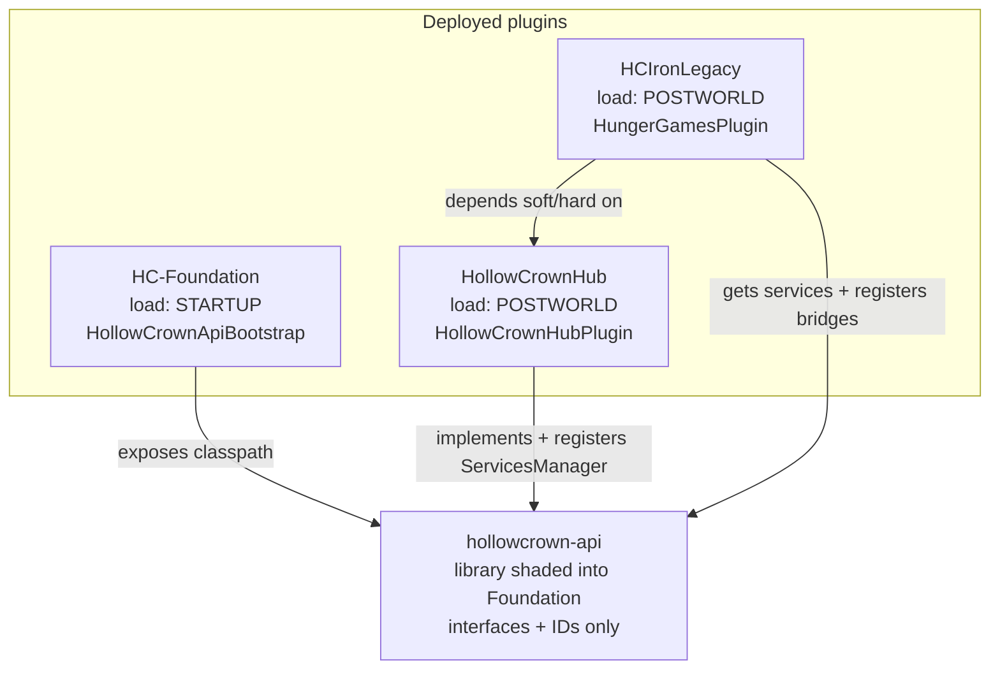
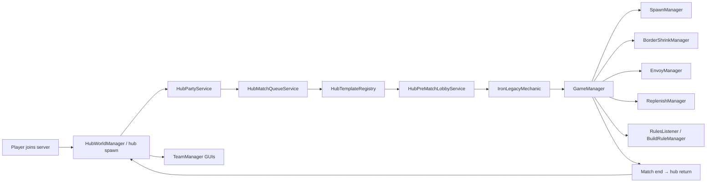
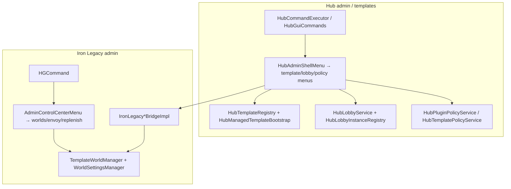
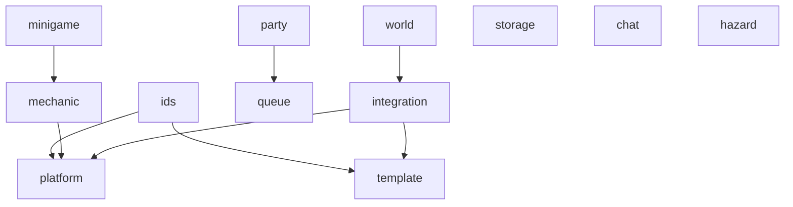
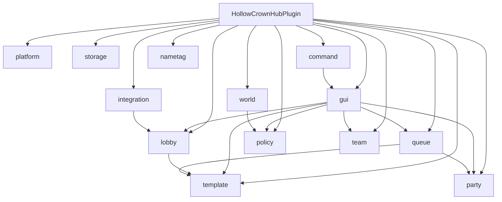
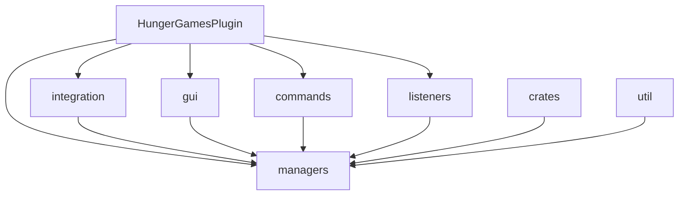

# Hollow Crown — full architecture & file threading

Dev map of **every Java source** in `api/`, `foundation/`, `hub/`, and `minigames/iron-legacy/`: what it is for, and what it connects to.

Generated from the tree as of this commit (**219** `.java` files). Edges are primarily **compile imports** of other `com.hollowcrown.*` types (plus the runtime service graph below). Same-package references without imports are not listed as edges.

Related: [REPO_LAYOUT.md](REPO_LAYOUT.md) · [PLATFORM_REFERENCE.md](PLATFORM_REFERENCE.md) · [PACKAGING.md](PACKAGING.md)

---

## 1. Server load order & Bukkit services

Three JARs on the Paper server (not one uber-JAR). Foundation loads first so the API package exists; Hub registers services; Iron Legacy consumes them and registers bridges back.

### Services Hub registers (Iron Legacy looks these up)

| Service interface (api) | Hub implementation | Purpose |
|------------------------|--------------------|---------|
| `GamePlatform` | `DefaultGamePlatform` | Mechanic register, hub spawn, match instance reservation |
| `TemplateRegistry` | `HubTemplateApiRegistry` → `HubTemplateRegistry` | Template catalog for queue/lobby/match |
| `PartyService` | `HubPartyService` | Parties for queue |
| `MatchQueueService` | `HubMatchQueueService` | Match enqueue |
| `StorageProvider` | SQL or YAML provider | Persistence |
| `HubWorldApi` | `HubWorldManager` (via adapter) | Hub world / PvP helpers |
| `HubAdminGui` | `DefaultHubAdminGui` | Admin GUI entry |
| `HubPlayerMenus` | `DefaultHubPlayerMenus` | Player menus |
| `HubPluginPolicyApi` | `HubPluginPolicyApiAdapter` | Plugin allow/deny per template |
| `HubTemplatePublishLifecycle` | publish gate/pending | Template publish chat flow |
| `PreMatchLobbyService` | `HubPreMatchLobbyService` | Pre-match lobby arena |
| `IronLegacyMatchInstanceRuntime` | `HubIronLegacyMatchInstanceRuntime` | Hub-side match instance runtime for IL |

### Services / bridges Iron Legacy registers

| API type | IL implementation | Purpose |
|---------|-------------------|---------|
| `MinigameMechanic` via `GamePlatform.register` | `IronLegacyMechanic` | Hub knows how to run IL matches |
| `IronLegacyHubBridge` | `IronLegacyHubBridgeImpl` | Hub admin/world ops into IL |
| `IronLegacyLobbyBridge` | `IronLegacyLobbyBridgeImpl` | Lobby shard / IL lobby ops |
| `IronLegacyTemplateAdmin` | `IronLegacyTemplateAdminImpl` | Template admin from Hub GUIs |
| `IronLegacyWorldsCatalog` | (via bridge/support) | Worlds list for Hub menus |
| `GameWorldScopeResolver` | `IlGameWorldScopeResolver` | Which world is hub/lobby/match |

---

## 2. End-to-end player / match thread

---

## 3. Package maps

### API (`com.hollowcrown.api`) — contracts only

### Hub (`com.hollowcrown.hub`)

### Iron Legacy (`com.hollowcrown.hungergames`)

---

## 4. Hub wiring detail (plugin → subsystems)

```mermaid
flowchart TB
  P[HollowCrownHubPlugin.onEnable]
  P --> SQL[HubSqlRuntime / HubYamlStorageProvider]
  P --> GP[DefaultGamePlatform]
  P --> TR[HubTemplateRegistry]
  P --> TAR[HubTemplateApiRegistry]
  P --> LIR[HubLobbyInstanceRegistry]
  P --> LS[HubLobbyService]
  P --> PS[HubPartyService]
  P --> MQ[HubMatchQueueService]
  P --> HWY[HubWorldYaml]
  P --> HWM[HubWorldManager]
  P --> Menus[DefaultHubPlayerMenus]
  P --> Admin[DefaultHubAdminGui]
  P --> Pol[HubPluginPolicyService]
  P --> TPol[HubTemplatePolicyService]
  P --> NT[HubNametagService]
  P --> Pre[HubPreMatchLobbyService]
  P --> ILSup[HubIronLegacySupport]
  P --> ILRun[HubIronLegacyMatchInstanceRuntime]
  HWM --> CV[HubCombatVitals]
  Admin --> Shell[HubAdminShellMenu + child menus]
```

---

## 5. Iron Legacy wiring detail (plugin → managers)

```mermaid
flowchart TB
  P[HungerGamesPlugin.onEnable]
  P --> Req[requireHollowCrownStack + registerWithHollowCrownHub]
  Req --> Mech[IronLegacyMechanic on GamePlatform]
  Req --> HB[IronLegacyHubBridgeImpl]
  Req --> LB[IronLegacyLobbyBridgeImpl]
  Req --> TA[IronLegacyTemplateAdminImpl]
  P --> CF[ConfigFilesManager]
  P --> SR[ServerRoleManager]
  P --> VB[VelocityBridgeManager]
  P --> SS[SharedStateManager]
  P --> LM[LobbyManager]
  P --> LSM[LobbyShardManager]
  P --> TWM[TemplateWorldManager]
  P --> WSM[WorldSettingsManager]
  P --> SM[SpawnManager]
  P --> GM[GameManager]
  P --> EM[EnvoyManager]
  P --> RM[ReplenishManager]
  P --> GD[GiftDropManager]
  P --> BR[BuildRuleManager]
  P --> KL[KillLeaderboardManager + Sidebar]
  GM --> SM
  GM --> EM
  GM --> Border[BorderShrinkManager]
```

---

## 6. Complete file catalog

For each file: **purpose**, **connects to** (HC types it imports), **used by** (other HC files that import it).

### 6.1 API — `api/src/main/java` (library contracts)

_39 files_

#### Package group: `chat`

| File | Kind | Purpose | Connects to | Used by |
|------|------|---------|-------------|---------|
| `com/hollowcrown/api/chat/TeamChatProfile.java` | record | API model for a player’s team-chat channel profile. | — | — |
| `com/hollowcrown/api/chat/TeamChatProvider.java` | interface | API service for team chat routing between Hub teams and minigames. | — | `HungerGamesPlugin` |

#### Package group: `hazard`

| File | Kind | Purpose | Connects to | Used by |
|------|------|---------|-------------|---------|
| `com/hollowcrown/api/hazard/EnvironmentalHazardsLifecycle.java` | interface | API hooks for Environmental Hazards plugin enable/disable coordination. | — | `EnvironmentalHazardsBridge` |
| `com/hollowcrown/api/hazard/EnvironmentalHazardsTriggerCleanup.java` | interface | API hook to clear hazard triggers when a match/world ends. | — | `EnvironmentalHazardsBridge` |

#### Package group: `ids`

| File | Kind | Purpose | Connects to | Used by |
|------|------|---------|-------------|---------|
| `com/hollowcrown/api/ids/LobbyInstanceId.java` | record | Typed ID for a Hub-managed lobby instance. | — | `MechanicContext`, `HubLobbyService` |
| `com/hollowcrown/api/ids/MechanicId.java` | record | Typed ID for a registered minigame mechanic. | — | `MinigamePluginKey`, `GamePlatform`, `HubLobbyService`, `DefaultGamePlatform` |
| `com/hollowcrown/api/ids/TemplateKey.java` | record | Typed key for a world/template folder name. | — | `MechanicContext`, `HubLobbyService` |

#### Package group: `integration`

| File | Kind | Purpose | Connects to | Used by |
|------|------|---------|-------------|---------|
| `com/hollowcrown/api/integration/HubAdminGui.java` | interface | API: open Hub admin GUIs from other plugins. | — | `HollowCrownHubPlugin`, `DefaultHubAdminGui`, `AdminControlCenterMenu`, `GameLobbyMenu` |
| `com/hollowcrown/api/integration/HubPlayerMenus.java` | interface | API: open player-facing Hub menus (party, join, etc.). | — | `HollowCrownHubPlugin`, `DefaultHubPlayerMenus`, `HubPreMatchLobbyArenaListener`, `HubWorldManager`, `HungerGamesPlugin` |
| `com/hollowcrown/api/integration/HubPluginPolicyApi.java` | interface | API: query whether a Bukkit plugin is allowed in a template world. | — | `HollowCrownHubPlugin`, `HubPluginPolicyApiAdapter` |
| `com/hollowcrown/api/integration/HubTemplatePublishLifecycle.java` | interface | API: template publish chat/confirm lifecycle for Hub. | — | `HollowCrownHubPlugin`, `IronLegacyTemplateAdminImpl` |
| `com/hollowcrown/api/integration/HubWorldApi.java` | interface | API: Hub world helpers (spawn, PvP zone queries). | — | `HollowCrownHubPlugin`, `HubWorldAdminCommands`, `HubPreMatchLobbyArenaListener`, `HubPreMatchLobbyService`, `HubWorldManager`, `HungerGamesPlugin`, `WorldsHubSettingsMenu`, `HubShardBoundaryListener`, +1 more |
| `com/hollowcrown/api/integration/IronLegacyHubBridge.java` | interface | API: Hub → Iron Legacy hub-world / import operations. | — | `HubWorldManager`, `HungerGamesPlugin`, `IronLegacyHubBridgeImpl` |
| `com/hollowcrown/api/integration/IronLegacyHubImportResult.java` | record | API DTO for IL hub-world import outcomes. | — | `HubTemplateWorldsCommands`, `IronLegacyTemplateAdminImpl` |
| `com/hollowcrown/api/integration/IronLegacyLobbyBridge.java` | interface | API: Hub → Iron Legacy lobby-shard operations. | — | `HollowCrownHubPlugin`, `HubPreMatchLobbyArenaListener`, `HubPreMatchLobbyService`, `HungerGamesPlugin`, `IronLegacyLobbyBridgeImpl` |
| `com/hollowcrown/api/integration/IronLegacyMatchInstanceRuntime.java` | interface | API: runtime handle for an IL match world instance. | — | `HollowCrownHubPlugin`, `HubIronLegacyMatchInstanceRuntime`, `HungerGamesPlugin` |
| `com/hollowcrown/api/integration/IronLegacyTemplateAdmin.java` | interface | API: template admin actions exposed to Hub GUIs. | — | `HubIlAdminHints`, `HubIlWorldInput`, `HubIlWorldSetCommand`, `HubTemplateCommands`, `HubTemplateWorldsCommands`, `HubIlSnapshotListMenu`, `HubIlTemplateDetailMenu`, `HubIlTemplateListMenu`, +5 more |
| `com/hollowcrown/api/integration/IronLegacyTemplateRow.java` | record | API row model for an IL template in Hub lists. | — | `HubTemplateWorldsCommands`, `HubIlTemplateDetailMenu`, `HubIlTemplateListMenu`, `HubLobbyService`, `HubTemplatePublishGate`, `IronLegacyTemplateAdminImpl` |
| `com/hollowcrown/api/integration/IronLegacyWorldsCatalog.java` | interface | API: list IL worlds/templates for Hub browsers. | — | `HollowCrownHubPlugin`, `HubIronLegacyMatchInstanceRuntime`, `HubLobbyWorldsYaml`, `HungerGamesPlugin`, `IronLegacyLobbyBridgeImpl`, `IronLegacyTemplateAdminImpl` |
| `com/hollowcrown/api/integration/PreMatchLobbyService.java` | interface | API: pre-match lobby arena join/leave/state. | — | `HollowCrownHubPlugin`, `HubPartyMenu`, `HubLobbyService`, `HubPreMatchLobbyArenaListener`, `HubPreMatchLobbyService`, `HubNametagService`, `HubPluginPolicyApiAdapter`, `HubPluginPolicyEnforcer`, +3 more |

#### Package group: `mechanic`

| File | Kind | Purpose | Connects to | Used by |
|------|------|---------|-------------|---------|
| `com/hollowcrown/api/mechanic/MechanicContext.java` | record | API context passed into a MinigameMechanic for a match. | `LobbyInstanceId`, `TemplateKey` | `HubLobbyService`, `HubManagedLobbyRegistry`, `IronLegacyMechanic` |
| `com/hollowcrown/api/mechanic/MinigameMechanic.java` | interface | API contract a minigame implements and registers on GamePlatform. | — | `MinigameBootstrap`, `GamePlatform`, `HubLobbyService`, `DefaultGamePlatform`, `IronLegacyMechanic` |

#### Package group: `minigame`

| File | Kind | Purpose | Connects to | Used by |
|------|------|---------|-------------|---------|
| `com/hollowcrown/api/minigame/MinigameBootstrap.java` | class | API helper constants/helpers for minigame plugin bootstrap. | `HollowCrownApiVersion`, `MinigameMechanic`, `GamePlatform` | `HungerGamesPlugin` |
| `com/hollowcrown/api/minigame/MinigamePluginKey.java` | record | API identity for a minigame plugin (id + display name). | `HollowCrownApiVersion`, `MechanicId` | `HungerGamesPlugin` |
| `com/hollowcrown/api/minigame/package-info.java` | package-info | Package docs for `com.hollowcrown.api.minigame` (minigame bootstrap contracts). | — | — |

#### Package group: `party`

| File | Kind | Purpose | Connects to | Used by |
|------|------|---------|-------------|---------|
| `com/hollowcrown/api/party/PartyService.java` | interface | API: create/join/leave parties used by match queue. | — | `HollowCrownHubPlugin`, `HubPartyMenu`, `TeamMembersMenu`, `HubPreMatchLobbyArenaListener`, `HubPreMatchLobbyService`, `HubPartyService`, `HubHubRouting`, `HubMatchQueueService`, +3 more |
| `com/hollowcrown/api/party/PartyView.java` | class | API read-only view of a party. | — | `HubDebugWhy`, `HubPlayerCommand`, `HubPartyLobbyTrimMenu`, `HubPartyMenu`, `HubLobbyService`, `HubPreMatchLobbyArenaListener`, `HubPreMatchLobbyService`, `HubParty`, +7 more |

#### Package group: `platform`

| File | Kind | Purpose | Connects to | Used by |
|------|------|---------|-------------|---------|
| `com/hollowcrown/api/platform/GamePlatform.java` | interface | API façade: register mechanics, hub spawn, reserve match instances. | `HollowCrownApiVersion`, `MechanicId`, `MinigameMechanic` | `MinigameBootstrap`, `HollowCrownHubPlugin`, `HubCommandExecutor`, `HubDebugWhy`, `HubTemplateCommands`, `HubIronLegacyMatchInstanceRuntime`, `DefaultGamePlatform`, `HungerGamesPlugin` |
| `com/hollowcrown/api/platform/HubSpawn.java` | record | API model for hub spawn location. | — | `HollowCrownHubPlugin`, `HubCommandExecutor`, `HubDebugWhy`, `LobbyJoinMenuListener`, `HubIronLegacyMatchInstanceRuntime`, `DefaultGamePlatform`, `HubHubRouting`, `HubHubSpawns`, +1 more |
| `com/hollowcrown/api/platform/MatchInstanceReservation.java` | record | API handle for a reserved match world instance. | — | `DefaultGamePlatform`, `TemplateWorldManager` |

#### Package group: `queue`

| File | Kind | Purpose | Connects to | Used by |
|------|------|---------|-------------|---------|
| `com/hollowcrown/api/queue/MatchEnqueueResult.java` | class | API result of trying to enqueue for a match. | — | `HubQueueCommands`, `MatchEnqueueMessages`, `LobbyJoinMenuListener`, `HubLobbyService`, `HubMatchQueueService` |
| `com/hollowcrown/api/queue/MatchQueueService.java` | interface | API matchmaking enqueue/dequeue. | — | `HollowCrownHubPlugin`, `HubDebugWhy`, `HubQueueCommands`, `HubMatchQueueService`, `HungerGamesPlugin` |

#### Package group: `storage`

| File | Kind | Purpose | Connects to | Used by |
|------|------|---------|-------------|---------|
| `com/hollowcrown/api/storage/StorageBackend.java` | enum | API enum/marker for storage backend kind. | — | `HubSqlStorageProvider`, `HubYamlStorageProvider` |
| `com/hollowcrown/api/storage/StorageProvider.java` | interface | API key-value / schema storage used by Hub. | — | `HollowCrownHubPlugin`, `HubSqlStorageProvider`, `HubYamlStorageProvider` |

#### Package group: `template`

| File | Kind | Purpose | Connects to | Used by |
|------|------|---------|-------------|---------|
| `com/hollowcrown/api/template/TemplateEntry.java` | class | API view of one registered template. | — | `HubTemplateApiRegistry`, `IlGameWorldScopeResolver`, `TemplateWorldManager` |
| `com/hollowcrown/api/template/TemplateRegistry.java` | interface | API registry of templates visible to queue/lobby. | — | `HollowCrownHubPlugin`, `HubTemplateApiRegistry`, `HungerGamesPlugin` |

#### Package group: `world`

| File | Kind | Purpose | Connects to | Used by |
|------|------|---------|-------------|---------|
| `com/hollowcrown/api/world/GameWorldScope.java` | record | API enum: HUB / LOBBY / MATCH / OTHER world scope. | — | `IlGameWorldScopeResolver` |
| `com/hollowcrown/api/world/GameWorldScopeResolver.java` | interface | API: resolve which scope a Bukkit World belongs to. | — | `HungerGamesPlugin`, `IlGameWorldScopeResolver` |

#### Package group: `(root)`

| File | Kind | Purpose | Connects to | Used by |
|------|------|---------|-------------|---------|
| `com/hollowcrown/api/HollowCrownApiVersion.java` | class | Integer SCHEMA constant for the hollowcrown-api contract version. | — | `MinigameBootstrap`, `MinigamePluginKey`, `GamePlatform` |

### 6.2 Foundation — `foundation/src/main/java` (plugin bootstrap)

_1 files_

#### Package group: `bootstrap`

| File | Kind | Purpose | Connects to | Used by |
|------|------|---------|-------------|---------|
| `com/hollowcrown/api/bootstrap/HollowCrownApiBootstrap.java` | class | Foundation plugin main class — STARTUP load; puts shaded hollowcrown-api on the classpath. | — | — |

### 6.3 Hub — `hub/src/main/java` (HollowCrownHub)

_114 files_

#### Package group: `command`

| File | Kind | Purpose | Connects to | Used by |
|------|------|---------|-------------|---------|
| `com/hollowcrown/hub/command/HubCommandExecutor.java` | class | Root `/hub` admin command router. | `GamePlatform`, `HubSpawn`, `HollowCrownHubPlugin`, `HubLog`, `HubIronLegacySupport`, `HubHubSpawns`, `TeamManager` | `HollowCrownHubPlugin` |
| `com/hollowcrown/hub/command/HubDebugWhy.java` | class | Debug helper explaining why a Hub action failed. | `PartyView`, `GamePlatform`, `HubSpawn`, `MatchQueueService`, `HollowCrownHubPlugin`, `HubLog`, `HubLobbyInstanceRecord` | — |
| `com/hollowcrown/hub/command/HubGuiCommands.java` | class | Commands that open Hub admin/player GUIs. | `HollowCrownHubPlugin`, `HubIlTemplateListMenu`, `LobbyAdminMenu`, `HubIronLegacySupport` | — |
| `com/hollowcrown/hub/command/HubIlAdminHints.java` | class | Chat hints for Iron Legacy admin flows from Hub. | `IronLegacyTemplateAdmin` | `HubIlTemplateDetailMenu` |
| `com/hollowcrown/hub/command/HubIlWorldInput.java` | class | Chat capture for IL world name/path input from Hub. | `IronLegacyTemplateAdmin` | `HubTemplatePublishChatListener` |
| `com/hollowcrown/hub/command/HubIlWorldSetCommand.java` | class | Command to set IL world linkage from Hub. | `IronLegacyTemplateAdmin`, `HollowCrownHubPlugin` | — |
| `com/hollowcrown/hub/command/HubJoinCommands.java` | class | Player commands to join lobbies/queues via Hub. | `HollowCrownHubPlugin`, `LobbyJoinMechanicMenu` | — |
| `com/hollowcrown/hub/command/HubLobbyCommands.java` | class | Admin commands for lobby instances. | `HollowCrownHubPlugin`, `HubLog`, `LobbyAdminMenu`, `HubLobbyInstanceRecord`, `HubLobbyService`, `LobbyInstanceState` | — |
| `com/hollowcrown/hub/command/HubPartyCommands.java` | class | Player/admin party commands. | `HollowCrownHubPlugin`, `HubLog`, `HubPartyListener`, `HubPartyService`, `HubPartyText` | — |
| `com/hollowcrown/hub/command/HubPlayerCommand.java` | class | General player-facing Hub commands. | `PartyView`, `HollowCrownHubPlugin`, `HubLog`, `HubHubRouting`, `HubHubSpawns` | `HollowCrownHubPlugin` |
| `com/hollowcrown/hub/command/HubQueueCommands.java` | class | Match queue enqueue/leave commands. | `MatchEnqueueResult`, `MatchQueueService`, `HollowCrownHubPlugin`, `HubLog` | — |
| `com/hollowcrown/hub/command/HubTemplateCommands.java` | class | Template CRUD/admin commands. | `IronLegacyTemplateAdmin`, `GamePlatform`, `HollowCrownHubPlugin`, `HubIronLegacySupport`, `HubTemplateEntry`, `HubTemplateRegistry`, `HubTemplateWorldBootstrap` | — |
| `com/hollowcrown/hub/command/HubTemplateLobbyCommands.java` | class | Commands tying templates to lobby settings. | `HollowCrownHubPlugin` | — |
| `com/hollowcrown/hub/command/HubTemplateWorldsCommands.java` | class | Commands for template world folders/publish. | `IronLegacyHubImportResult`, `IronLegacyTemplateAdmin`, `IronLegacyTemplateRow`, `HollowCrownHubPlugin`, `HubIlIconPreviewMenu`, `HubIlTemplateListMenu`, `HubIronLegacySupport`, `HubManagedTemplateBootstrap`, +3 more | — |
| `com/hollowcrown/hub/command/HubWorldAdminCommands.java` | class | Hub world / PvP zone admin commands. | `HubWorldApi`, `HollowCrownHubPlugin`, `HubLog` | — |
| `com/hollowcrown/hub/command/MatchEnqueueMessages.java` | class | User-facing messages for queue enqueue results. | `MatchEnqueueResult` | `LobbyJoinMenuListener`, `HubLobbyService` |
| `com/hollowcrown/hub/command/TeamAllyCommandExecutor.java` | class | `/team ally` command executor. | `HollowCrownHubPlugin`, `HubIronLegacySupport`, `TeamManager` | `HollowCrownHubPlugin` |
| `com/hollowcrown/hub/command/TeamCommands.java` | class | Team create/invite/leave/etc. command router. | `HollowCrownHubPlugin`, `HubPartyService`, `TeamManager` | — |
| `com/hollowcrown/hub/command/TeamRivalCommandExecutor.java` | class | `/team rival` command executor. | `HollowCrownHubPlugin`, `TeamManager` | `HollowCrownHubPlugin` |

#### Package group: `gui`

| File | Kind | Purpose | Connects to | Used by |
|------|------|---------|-------------|---------|
| `com/hollowcrown/hub/gui/DefaultHubAdminGui.java` | class | HubAdminGui impl — opens admin shell menus. | `HubAdminGui`, `HollowCrownHubPlugin`, `HubIronLegacySupport` | `HollowCrownHubPlugin` |
| `com/hollowcrown/hub/gui/HubAdminShellMenu.java` | class | Top-level Hub admin inventory menu. | `HollowCrownHubPlugin`, `HubIronLegacySupport` | — |
| `com/hollowcrown/hub/gui/HubHubTemplateBrowserMenu.java` | class | Browse hub-owned templates. | `HollowCrownHubPlugin`, `HubTemplateEntry` | — |
| `com/hollowcrown/hub/gui/HubIlIconPreviewMenu.java` | class | Preview Iron Legacy template icons. | — | `HubTemplateWorldsCommands` |
| `com/hollowcrown/hub/gui/HubIlSnapshotListMenu.java` | class | List IL world snapshots from Hub. | `IronLegacyTemplateAdmin`, `HollowCrownHubPlugin` | — |
| `com/hollowcrown/hub/gui/HubIlTemplateDetailMenu.java` | class | Detail/edit one IL template from Hub. | `IronLegacyTemplateAdmin`, `IronLegacyTemplateRow`, `HollowCrownHubPlugin`, `HubIlAdminHints` | — |
| `com/hollowcrown/hub/gui/HubIlTemplateListMenu.java` | class | List IL templates in Hub admin. | `IronLegacyTemplateAdmin`, `IronLegacyTemplateRow`, `HollowCrownHubPlugin` | `HubGuiCommands`, `HubTemplateWorldsCommands` |
| `com/hollowcrown/hub/gui/HubMatchTemplateListMenu.java` | class | Pick a template for matchmaking admin. | `HollowCrownHubPlugin` | — |
| `com/hollowcrown/hub/gui/HubMenuListener.java` | class | Click router for Hub inventory menus. | — | `HollowCrownHubPlugin` |
| `com/hollowcrown/hub/gui/HubMenuView.java` | class | Base/helper for Hub chest menu views. | — | — |
| `com/hollowcrown/hub/gui/HubPartyLobbyTrimMenu.java` | class | Trim party members before lobby/match. | `PartyView`, `HollowCrownHubPlugin`, `HubLobbyService` | — |
| `com/hollowcrown/hub/gui/HubPartyMenu.java` | class | Player party management GUI. | `PreMatchLobbyService`, `PartyService`, `PartyView`, `HollowCrownHubPlugin`, `HubPartyListener`, `HubPartyText` | `DefaultHubPlayerMenus` |
| `com/hollowcrown/hub/gui/HubPluginAllocationLandingMenu.java` | class | Landing menu for per-template plugin allocation. | `HollowCrownHubPlugin`, `HubPluginPolicyService` | — |
| `com/hollowcrown/hub/gui/HubPluginPolicyAdminMenu.java` | class | Admin which plugins are allowed on a template. | `HollowCrownHubPlugin`, `HubPluginPolicyService` | — |
| `com/hollowcrown/hub/gui/HubQueueOverviewMenu.java` | class | See who is queued. | `HollowCrownHubPlugin`, `HubTemplateEntry` | — |
| `com/hollowcrown/hub/gui/HubTemplateBlacklistMenu.java` | class | Blacklist templates from queue/join. | `HollowCrownHubPlugin`, `HubPluginPolicyService`, `HubTemplatePolicyService` | `HubTemplatePolicyCloseListener` |
| `com/hollowcrown/hub/gui/HubTemplateGeneralSettingsMenu.java` | class | General settings for a Hub template. | `HollowCrownHubPlugin`, `HubIronLegacySupport`, `HubTemplatePolicyService` | `HubTemplatePolicyCloseListener` |
| `com/hollowcrown/hub/gui/HubTemplateLandingMenu.java` | class | Template admin landing menu. | `HollowCrownHubPlugin` | `HubTemplatePolicyCloseListener` |
| `com/hollowcrown/hub/gui/LobbyAdminMenu.java` | class | Admin GUI for a lobby instance. | `HollowCrownHubPlugin`, `HubLobbyInstanceRecord`, `HubLobbyService`, `LobbyInstanceState` | `HubGuiCommands`, `HubLobbyCommands` |
| `com/hollowcrown/hub/gui/LobbyAdminMenuHolder.java` | class | InventoryHolder for lobby admin GUI. | `HollowCrownHubPlugin` | — |
| `com/hollowcrown/hub/gui/LobbyAdminMenuListener.java` | class | Click handler for lobby admin GUI. | `HubLog` | `HollowCrownHubPlugin` |
| `com/hollowcrown/hub/gui/LobbyJoinInstanceMenu.java` | class | Player picks a lobby instance to join. | `HollowCrownHubPlugin`, `HubLobbyInstanceRecord`, `HubLobbyService` | — |
| `com/hollowcrown/hub/gui/LobbyJoinInstanceMenuHolder.java` | class | InventoryHolder for instance join menu. | `HollowCrownHubPlugin` | — |
| `com/hollowcrown/hub/gui/LobbyJoinMechanicMenu.java` | class | Player picks a mechanic/minigame to join. | `HollowCrownHubPlugin`, `HubMechanics`, `HubTemplateEntry` | `HubJoinCommands`, `DefaultHubPlayerMenus` |
| `com/hollowcrown/hub/gui/LobbyJoinMechanicMenuHolder.java` | class | InventoryHolder for mechanic join menu. | `HollowCrownHubPlugin` | — |
| `com/hollowcrown/hub/gui/LobbyJoinMenuListener.java` | class | Click handler for lobby-join flow menus. | `HubSpawn`, `MatchEnqueueResult`, `HubLog`, `MatchEnqueueMessages` | `HollowCrownHubPlugin` |
| `com/hollowcrown/hub/gui/LobbyJoinTemplateCreateFlow.java` | class | Multi-step GUI/chat flow to create a lobby from a template. | `HollowCrownHubPlugin`, `HubLog`, `HubIronLegacySupport`, `HubMechanics`, `HubTemplateRegistry`, `HubTemplateWorldBootstrap` | — |
| `com/hollowcrown/hub/gui/LobbyJoinTemplateMenu.java` | class | Player picks a template when joining. | `HollowCrownHubPlugin`, `HubLobbyService`, `HubMechanics`, `HubTemplateEntry` | — |
| `com/hollowcrown/hub/gui/LobbyJoinTemplateMenuHolder.java` | class | InventoryHolder for template join menu. | `HollowCrownHubPlugin` | — |
| `com/hollowcrown/hub/gui/TeamAllyAndRivalMenu.java` | class | Manage team allies and rivals. | `TeamManager` | — |
| `com/hollowcrown/hub/gui/TeamColorMenu.java` | class | Pick team color. | `TeamManager` | — |
| `com/hollowcrown/hub/gui/TeamInviteMenu.java` | class | Invite players to a team. | `TeamManager` | — |
| `com/hollowcrown/hub/gui/TeamJoinMenu.java` | class | Join an existing team. | `TeamManager` | — |
| `com/hollowcrown/hub/gui/TeamMainMenu.java` | class | Main team management menu for a member. | `HollowCrownHubPlugin`, `TeamManager`, `TeamNamingRules` | `HubPreMatchLobbyArenaListener`, `HGCommand` |
| `com/hollowcrown/hub/gui/TeamMembersMenu.java` | class | Team Members Manager — roster, kick, leadership claim. | `PartyService`, `HollowCrownHubPlugin`, `TeamManager` | — |
| `com/hollowcrown/hub/gui/TeamRecolorMenu.java` | class | Recolor team display. | `TeamManager` | — |
| `com/hollowcrown/hub/gui/TeamsMenu.java` | class | Browse/list teams. | `HollowCrownHubPlugin`, `TeamManager` | `HGCommand` |

#### Package group: `integration`

| File | Kind | Purpose | Connects to | Used by |
|------|------|---------|-------------|---------|
| `com/hollowcrown/hub/integration/DefaultHubPlayerMenus.java` | class | HubPlayerMenus impl for party/join/team menus. | `HubPlayerMenus`, `HollowCrownHubPlugin`, `HubPartyMenu`, `LobbyJoinMechanicMenu` | `HollowCrownHubPlugin` |
| `com/hollowcrown/hub/integration/HubIronLegacyMatchInstanceRuntime.java` | class | Hub-side IronLegacyMatchInstanceRuntime for reserved match worlds. | `IronLegacyMatchInstanceRuntime`, `IronLegacyWorldsCatalog`, `GamePlatform`, `HubSpawn`, `HollowCrownHubPlugin`, `TeamManager`, `WorldFolderCopier` | `HollowCrownHubPlugin` |
| `com/hollowcrown/hub/integration/HubIronLegacySupport.java` | class | Glue: resolve IL bridges/catalog from ServicesManager for Hub GUIs. | `IronLegacyTemplateAdmin` | `HollowCrownHubPlugin`, `HubCommandExecutor`, `HubGuiCommands`, `HubTemplateCommands`, `HubTemplateWorldsCommands`, `TeamAllyCommandExecutor`, `DefaultHubAdminGui`, `HubAdminShellMenu`, +6 more |

#### Package group: `listener`

| File | Kind | Purpose | Connects to | Used by |
|------|------|---------|-------------|---------|
| `com/hollowcrown/hub/listener/HubPlayerConnectionListener.java` | class | Join/quit cleanup for party, lobby, nametag, queue. | `HollowCrownHubPlugin`, `HubLog` | — |

#### Package group: `lobby`

| File | Kind | Purpose | Connects to | Used by |
|------|------|---------|-------------|---------|
| `com/hollowcrown/hub/lobby/HubLobbyArenaState.java` | class | In-memory state for pre-match lobby arenas. | — | `HollowCrownHubPlugin` |
| `com/hollowcrown/hub/lobby/HubLobbyInstanceRecord.java` | class | Persisted record of one lobby instance. | — | `HubDebugWhy`, `HubLobbyCommands`, `LobbyAdminMenu`, `LobbyJoinInstanceMenu`, `HubManagedTemplateBootstrap` |
| `com/hollowcrown/hub/lobby/HubLobbyInstanceRegistry.java` | class | Create/load/list/destroy lobby instances (YAML/SQL). | `HollowCrownHubPlugin` | `HollowCrownHubPlugin` |
| `com/hollowcrown/hub/lobby/HubLobbyJdbcSync.java` | class | JDBC sync for lobby instance rows. | `HollowCrownHubPlugin` | — |
| `com/hollowcrown/hub/lobby/HubLobbyLayout.java` | class | Disk layout paths under hch-worlds for lobbies. | `HollowCrownHubPlugin` | `HollowCrownHubPlugin` |
| `com/hollowcrown/hub/lobby/HubLobbyService.java` | class | High-level lobby world provision and player send. | `LobbyInstanceId`, `MechanicId`, `TemplateKey`, `IronLegacyTemplateRow`, `PreMatchLobbyService`, `MechanicContext`, `MinigameMechanic`, `PartyView`, +9 more | `HollowCrownHubPlugin`, `HubLobbyCommands`, `HubPartyLobbyTrimMenu`, `LobbyAdminMenu`, `LobbyJoinInstanceMenu`, `LobbyJoinTemplateMenu`, `HubPreMatchLobbyService` |
| `com/hollowcrown/hub/lobby/HubLobbyWandListener.java` | class | Admin wand for lobby region/circle selection. | `HollowCrownHubPlugin` | — |
| `com/hollowcrown/hub/lobby/HubLobbyWorldsYaml.java` | class | Read/write lobby-related worlds YAML. | `IronLegacyWorldsCatalog`, `HollowCrownHubPlugin`, `HubIronLegacySupport` | — |
| `com/hollowcrown/hub/lobby/HubPreMatchLobbyArenaListener.java` | class | Movement/PvP/rules inside pre-match lobby arenas. | `HubPlayerMenus`, `HubWorldApi`, `IronLegacyLobbyBridge`, `PreMatchLobbyService`, `PartyService`, `PartyView`, `HollowCrownHubPlugin`, `TeamMainMenu`, +2 more | `HollowCrownHubPlugin` |
| `com/hollowcrown/hub/lobby/HubPreMatchLobbyService.java` | class | PreMatchLobbyService impl — staging before GameManager. | `HubWorldApi`, `IronLegacyLobbyBridge`, `PreMatchLobbyService`, `PartyService`, `PartyView`, `HollowCrownHubPlugin`, `HubLog`, `HubPlayerFacingErrors`, +3 more | `HollowCrownHubPlugin` |
| `com/hollowcrown/hub/lobby/LobbyInstanceState.java` | enum | Enum/state machine values for lobby lifecycle. | — | `HubLobbyCommands`, `LobbyAdminMenu` |

#### Package group: `nametag`

| File | Kind | Purpose | Connects to | Used by |
|------|------|---------|-------------|---------|
| `com/hollowcrown/hub/nametag/HubNametagChatListener.java` | class | Applies team nametag formatting in chat. | — | — |
| `com/hollowcrown/hub/nametag/HubNametagService.java` | class | Scoreboard/nametag teams synced to Hub teams. | `PreMatchLobbyService`, `HollowCrownHubPlugin`, `HubTemplatePolicyService`, `TeamManager` | — |

#### Package group: `party`

| File | Kind | Purpose | Connects to | Used by |
|------|------|---------|-------------|---------|
| `com/hollowcrown/hub/party/HubParty.java` | class | In-memory party entity. | `PartyView` | — |
| `com/hollowcrown/hub/party/HubPartyJdbcSync.java` | class | Persist parties to SQL. | `HollowCrownHubPlugin` | — |
| `com/hollowcrown/hub/party/HubPartyListener.java` | class | Party-related Bukkit events. | `HollowCrownHubPlugin` | `HollowCrownHubPlugin`, `HubPartyCommands`, `HubPartyMenu` |
| `com/hollowcrown/hub/party/HubPartyService.java` | class | PartyService impl. | `PartyService`, `PartyView`, `HollowCrownHubPlugin`, `HubLog` | `HollowCrownHubPlugin`, `HubPartyCommands`, `TeamCommands` |
| `com/hollowcrown/hub/party/HubPartyText.java` | class | Party chat message formatting. | `HollowCrownHubPlugin`, `TeamManager` | `HubPartyCommands`, `HubPartyMenu`, `HubPreMatchLobbyArenaListener` |

#### Package group: `platform`

| File | Kind | Purpose | Connects to | Used by |
|------|------|---------|-------------|---------|
| `com/hollowcrown/hub/platform/DefaultGamePlatform.java` | class | GamePlatform impl — mechanics map, hub spawn, match reservations. | `MechanicId`, `MinigameMechanic`, `GamePlatform`, `HubSpawn`, `MatchInstanceReservation`, `HollowCrownHubPlugin`, `HubLog`, `HubTemplateEntry`, +1 more | `HollowCrownHubPlugin` |
| `com/hollowcrown/hub/platform/HubHubRouting.java` | class | Route players back to correct hub world/spawn. | `PartyService`, `PartyView`, `HubSpawn`, `HollowCrownHubPlugin` | `HubPlayerCommand` |
| `com/hollowcrown/hub/platform/HubHubSpawns.java` | class | Configured hub spawn locations. | `HubSpawn`, `HollowCrownHubPlugin` | `HollowCrownHubPlugin`, `HubCommandExecutor`, `HubPlayerCommand` |

#### Package group: `policy`

| File | Kind | Purpose | Connects to | Used by |
|------|------|---------|-------------|---------|
| `com/hollowcrown/hub/policy/HubPluginPolicyApiAdapter.java` | class | Adapts HubPluginPolicyService to HubPluginPolicyApi. | `HubPluginPolicyApi`, `PreMatchLobbyService`, `HollowCrownHubPlugin` | `HollowCrownHubPlugin` |
| `com/hollowcrown/hub/policy/HubPluginPolicyEnforcer.java` | class | Listener that blocks disallowed plugins’ effects in template worlds. | `PreMatchLobbyService`, `HollowCrownHubPlugin` | `HollowCrownHubPlugin` |
| `com/hollowcrown/hub/policy/HubPluginPolicyService.java` | class | Stores per-template plugin allow/deny lists. | `HollowCrownHubPlugin` | `HollowCrownHubPlugin`, `HubPluginAllocationLandingMenu`, `HubPluginPolicyAdminMenu`, `HubTemplateBlacklistMenu` |
| `com/hollowcrown/hub/policy/HubTemplatePolicyCloseListener.java` | class | Closes policy GUIs when inventory closes. | `HubTemplateBlacklistMenu`, `HubTemplateGeneralSettingsMenu`, `HubTemplateLandingMenu` | — |
| `com/hollowcrown/hub/policy/HubTemplatePolicyService.java` | class | Template-level Hub policy (blacklist, settings). | `HollowCrownHubPlugin` | `HubTemplateBlacklistMenu`, `HubTemplateGeneralSettingsMenu`, `HubNametagService` |

#### Package group: `queue`

| File | Kind | Purpose | Connects to | Used by |
|------|------|---------|-------------|---------|
| `com/hollowcrown/hub/queue/HubMatchQueueService.java` | class | MatchQueueService impl — party enqueue, template pick, start handoff. | `PartyService`, `PartyView`, `MatchEnqueueResult`, `MatchQueueService`, `HollowCrownHubPlugin`, `HubLog`, `HubTemplateEntry`, `HubTemplateRegistry` | `HollowCrownHubPlugin` |

#### Package group: `storage`

| File | Kind | Purpose | Connects to | Used by |
|------|------|---------|-------------|---------|
| `com/hollowcrown/hub/storage/HubSqlMigrations.java` | class | SQL schema version constants/migrations for Hub. | — | `HollowCrownHubPlugin` |
| `com/hollowcrown/hub/storage/HubSqlRuntime.java` | class | Hikari/JDBC pool bootstrap for Hub. | `HollowCrownHubPlugin` | `HollowCrownHubPlugin` |
| `com/hollowcrown/hub/storage/HubSqlStorageProvider.java` | class | StorageProvider backed by SQL. | `StorageBackend`, `StorageProvider` | — |
| `com/hollowcrown/hub/storage/HubYamlStorageProvider.java` | class | StorageProvider backed by YAML files. | `StorageBackend`, `StorageProvider` | `HollowCrownHubPlugin` |

#### Package group: `team`

| File | Kind | Purpose | Connects to | Used by |
|------|------|---------|-------------|---------|
| `com/hollowcrown/hub/team/HubLobbyTeamFormation.java` | class | How teams form inside Hub lobbies before match. | `PreMatchLobbyService`, `PartyService`, `PartyView`, `HollowCrownHubPlugin` | `HubPreMatchLobbyService` |
| `com/hollowcrown/hub/team/HubYaml.java` | class | YAML helpers for team persistence files. | — | — |
| `com/hollowcrown/hub/team/TeamListener.java` | class | Bukkit listeners for team membership/combat rules. | `HollowCrownHubPlugin` | `HollowCrownHubPlugin` |
| `com/hollowcrown/hub/team/TeamManager.java` | class | Core team roster, allies/rivals, leadership, persistence. | `HollowCrownHubPlugin` | `HollowCrownHubPlugin`, `HubCommandExecutor`, `TeamAllyCommandExecutor`, `TeamCommands`, `TeamRivalCommandExecutor`, `TeamAllyAndRivalMenu`, `TeamColorMenu`, `TeamInviteMenu`, +14 more |
| `com/hollowcrown/hub/team/TeamNamingRules.java` | class | Validation rules for team names. | `PartyView`, `HollowCrownHubPlugin` | `TeamMainMenu`, `HGCommand`, `IronLegacyLobbyBridgeImpl`, `GameManager` |

#### Package group: `template`

| File | Kind | Purpose | Connects to | Used by |
|------|------|---------|-------------|---------|
| `com/hollowcrown/hub/template/HubManagedTemplateBootstrap.java` | class | Ensure managed template folders exist and are registered. | `IronLegacyTemplateAdmin`, `HollowCrownHubPlugin`, `HubIronLegacySupport`, `HubLobbyInstanceRecord` | `HollowCrownHubPlugin`, `HubTemplateWorldsCommands` |
| `com/hollowcrown/hub/template/HubMechanics.java` | class | Known mechanic id helpers for Hub. | — | `HubTemplateWorldsCommands`, `LobbyJoinMechanicMenu`, `LobbyJoinTemplateCreateFlow`, `LobbyJoinTemplateMenu` |
| `com/hollowcrown/hub/template/HubTemplateApiRegistry.java` | class | TemplateRegistry façade over HubTemplateRegistry. | `TemplateEntry`, `TemplateRegistry` | `HollowCrownHubPlugin` |
| `com/hollowcrown/hub/template/HubTemplateEntry.java` | class | Concrete template entry with Hub fields. | — | `HubTemplateCommands`, `HubHubTemplateBrowserMenu`, `HubQueueOverviewMenu`, `LobbyJoinMechanicMenu`, `LobbyJoinTemplateMenu`, `HubLobbyService`, `DefaultGamePlatform`, `HubMatchQueueService` |
| `com/hollowcrown/hub/template/HubTemplatePublishChatListener.java` | class | Chat prompts during template publish. | `HollowCrownHubPlugin`, `HubIlWorldInput`, `HubIronLegacySupport` | — |
| `com/hollowcrown/hub/template/HubTemplatePublishGate.java` | class | Who may publish / publish prerequisites. | `IronLegacyTemplateAdmin`, `IronLegacyTemplateRow`, `HollowCrownHubPlugin` | `HubTemplateWorldsCommands` |
| `com/hollowcrown/hub/template/HubTemplatePublishPending.java` | class | Per-player pending publish state. | — | — |
| `com/hollowcrown/hub/template/HubTemplateRegistry.java` | class | Authoritative Hub template list + disk sync. | `HollowCrownHubPlugin`, `HubLog` | `HollowCrownHubPlugin`, `HubTemplateCommands`, `LobbyJoinTemplateCreateFlow`, `HubLobbyService`, `HubMatchQueueService` |
| `com/hollowcrown/hub/template/HubTemplateWorldBootstrap.java` | class | Copy/load template world folders on demand. | `HollowCrownHubPlugin` | `HubTemplateCommands`, `HubTemplateWorldsCommands`, `LobbyJoinTemplateCreateFlow` |

#### Package group: `util`

| File | Kind | Purpose | Connects to | Used by |
|------|------|---------|-------------|---------|
| `com/hollowcrown/hub/util/HubChatInput.java` | class | Capture next chat message from a player for GUI flows. | `HollowCrownHubPlugin` | — |
| `com/hollowcrown/hub/util/WorldFolderCopier.java` | class | Copy world folders for lobby/match instances. | — | `HubIronLegacyMatchInstanceRuntime`, `HubLobbyService`, `DefaultGamePlatform` |

#### Package group: `world`

| File | Kind | Purpose | Connects to | Used by |
|------|------|---------|-------------|---------|
| `com/hollowcrown/hub/world/HubCombatVitals.java` | class | One-shot heal/food/sat resets (peaceful hub; match countdown prepare). | — | `HubPreMatchLobbyArenaListener` |
| `com/hollowcrown/hub/world/HubPvpZoneWandListener.java` | class | Admin wand to define Hub PvP zones. | `HollowCrownHubPlugin` | — |
| `com/hollowcrown/hub/world/HubWorldManager.java` | class | Load/unload hub worlds, PvP zones, vitals hooks, HubWorldApi. | `HubPlayerMenus`, `HubWorldApi`, `IronLegacyHubBridge`, `HubSpawn`, `HollowCrownHubPlugin`, `HubLog` | `HollowCrownHubPlugin` |
| `com/hollowcrown/hub/world/HubWorldYaml.java` | class | Persist hub world and PvP zone config. | `HollowCrownHubPlugin` | `HollowCrownHubPlugin` |

#### Package group: `(plugin root)`

| File | Kind | Purpose | Connects to | Used by |
|------|------|---------|-------------|---------|
| `com/hollowcrown/hub/HollowCrownHubPlugin.java` | class | Hub plugin entry: wires storage, platform, templates, lobbies, party, queue, worlds/PvP, teams, GUIs; registers Bukkit services. | `HubAdminGui`, `HubPlayerMenus`, `HubPluginPolicyApi`, `HubTemplatePublishLifecycle`, `HubWorldApi`, `IronLegacyLobbyBridge`, `IronLegacyMatchInstanceRuntime`, `IronLegacyWorldsCatalog`, +42 more | `HubCommandExecutor`, `HubDebugWhy`, `HubGuiCommands`, `HubIlWorldSetCommand`, `HubJoinCommands`, `HubLobbyCommands`, `HubPartyCommands`, `HubPlayerCommand`, +75 more |
| `com/hollowcrown/hub/HubLog.java` | class | Hub logging helpers with consistent prefixes. | — | `HubCommandExecutor`, `HubDebugWhy`, `HubLobbyCommands`, `HubPartyCommands`, `HubPlayerCommand`, `HubQueueCommands`, `HubWorldAdminCommands`, `LobbyAdminMenuListener`, +10 more |
| `com/hollowcrown/hub/HubPlayerFacingErrors.java` | class | Sanitizes non-op player errors to generic OOPS; full detail for ops/console. | — | `HubLobbyService`, `HubPreMatchLobbyService` |

### 6.4 Iron Legacy — `minigames/iron-legacy/src/main/java` (HCIronLegacy)

_65 files_

#### Package group: `commands`

| File | Kind | Purpose | Connects to | Used by |
|------|------|---------|-------------|---------|
| `com/hollowcrown/hungergames/commands/HGCommand.java` | class | `/il` (and related) command router for IL admin/player actions. | `TeamMainMenu`, `TeamsMenu`, `TeamManager`, `TeamNamingRules`, `ChatInput`, `HungerGamesPlugin`, `AdminControlCenterMenu`, `EnvoyAdminMenu` | `HungerGamesPlugin` |

#### Package group: `crates`

| File | Kind | Purpose | Connects to | Used by |
|------|------|---------|-------------|---------|
| `com/hollowcrown/hungergames/crates/CrateType.java` | enum | Enum of envoy/care-package crate types. | — | `EnvoyPackageEditMenu`, `EnvoyPackagesMenu`, `EnvoyPackagesTrackingMenu`, `EnvoyTypesMenu`, `EnvoyManager`, `GiftDropManager` |
| `com/hollowcrown/hungergames/crates/FallingCrate.java` | class | Falling-block crate entity during envoy drops. | `HungerGamesPlugin` | `EnvoyManager`, `GiftDropManager` |

#### Package group: `gui`

| File | Kind | Purpose | Connects to | Used by |
|------|------|---------|-------------|---------|
| `com/hollowcrown/hungergames/gui/AdminControlCenterMenu.java` | class | Top IL admin control center GUI. | `HubAdminGui`, `HungerGamesPlugin` | `HGCommand` |
| `com/hollowcrown/hungergames/gui/CoreSettingsAdminMenu.java` | class | Core match settings admin GUI. | `HungerGamesPlugin` | — |
| `com/hollowcrown/hungergames/gui/EnvoyAdminMenu.java` | class | Envoy system admin root. | — | `HGCommand` |
| `com/hollowcrown/hungergames/gui/EnvoyGeneralSettingsMenu.java` | class | Envoy timing/general settings. | `HungerGamesPlugin`, `WorldEnvoyStorage`, `Yaml` | — |
| `com/hollowcrown/hungergames/gui/EnvoyPackageEditMenu.java` | class | Edit one envoy loot package. | `HungerGamesPlugin`, `CrateType` | — |
| `com/hollowcrown/hungergames/gui/EnvoyPackagesMenu.java` | class | List envoy packages. | `HungerGamesPlugin`, `CrateType` | — |
| `com/hollowcrown/hungergames/gui/EnvoyPackagesTrackingMenu.java` | class | Track active envoy packages in-world. | `HungerGamesPlugin`, `CrateType`, `EnvoyManager`, `GiftDropManager` | — |
| `com/hollowcrown/hungergames/gui/EnvoySpawnsMenu.java` | class | Manage envoy spawn locations. | `HungerGamesPlugin` | — |
| `com/hollowcrown/hungergames/gui/EnvoyTypesMenu.java` | class | Manage envoy crate types. | `CrateType` | — |
| `com/hollowcrown/hungergames/gui/GameLobbyMenu.java` | class | In-game lobby menu during IL wait. | `HubAdminGui`, `PartyView`, `HungerGamesPlugin`, `TemplateWorldManager` | — |
| `com/hollowcrown/hungergames/gui/GameWorldSettingsMenu.java` | class | Per-world game settings GUI. | `HungerGamesPlugin`, `WorldGameSettings`, `WorldSettingsManager` | — |
| `com/hollowcrown/hungergames/gui/GameWorldsListMenu.java` | class | List game worlds/templates in IL admin. | `HungerGamesPlugin`, `TemplateWorldManager` | — |
| `com/hollowcrown/hungergames/gui/MenuListener.java` | class | Click router for IL inventory menus. | — | `HungerGamesPlugin` |
| `com/hollowcrown/hungergames/gui/MenuView.java` | class | Base helpers for IL chest menus. | — | — |
| `com/hollowcrown/hungergames/gui/ReplenishAdminMenu.java` | class | Replenish-chest admin root. | `HungerGamesPlugin` | — |
| `com/hollowcrown/hungergames/gui/ReplenishChestsMenu.java` | class | List/edit replenish chests. | `HungerGamesPlugin` | — |
| `com/hollowcrown/hungergames/gui/TeamNameDatabaseAdminMenu.java` | class | Admin GUI for team name database (legacy/optional). | `TeamManager`, `HungerGamesPlugin` | — |
| `com/hollowcrown/hungergames/gui/WorldsAdminRootMenu.java` | class | Worlds admin root menu. | — | — |
| `com/hollowcrown/hungergames/gui/WorldsHubSettingsMenu.java` | class | Hub-related world settings inside IL. | `HubWorldApi`, `HungerGamesPlugin` | — |

#### Package group: `integration`

| File | Kind | Purpose | Connects to | Used by |
|------|------|---------|-------------|---------|
| `com/hollowcrown/hungergames/integration/EnvironmentalHazardsBridge.java` | class | Optional bridge to Environmental Hazards plugin. | `EnvironmentalHazardsLifecycle`, `EnvironmentalHazardsTriggerCleanup` | `TemplateWorldManager` |
| `com/hollowcrown/hungergames/integration/HubIntegrationRouting.java` | class | Helpers routing players/worlds through Hub vs IL. | `HungerGamesPlugin` | `GameManager` |
| `com/hollowcrown/hungergames/integration/HubManagedLobbyRegistry.java` | class | Tracks which lobbies Hub asked IL to treat as managed. | `MechanicContext` | `HungerGamesPlugin` |
| `com/hollowcrown/hungergames/integration/IlGameWorldScopeResolver.java` | class | GameWorldScopeResolver for IL worlds. | `TemplateEntry`, `GameWorldScope`, `GameWorldScopeResolver`, `HungerGamesPlugin` | `HungerGamesPlugin` |
| `com/hollowcrown/hungergames/integration/IronLegacyHubBridgeImpl.java` | record | IronLegacyHubBridge implementation. | `IronLegacyHubBridge`, `HungerGamesPlugin` | `HungerGamesPlugin` |
| `com/hollowcrown/hungergames/integration/IronLegacyLobbyBridgeImpl.java` | class | IronLegacyLobbyBridge implementation. | `IronLegacyLobbyBridge`, `IronLegacyWorldsCatalog`, `PartyService`, `PartyView`, `HollowCrownHubPlugin`, `TeamManager`, `TeamNamingRules`, `HungerGamesPlugin` | `HungerGamesPlugin` |
| `com/hollowcrown/hungergames/integration/IronLegacyMechanic.java` | class | MinigameMechanic for iron-legacy registered on Hub GamePlatform. | `MechanicContext`, `MinigameMechanic`, `HungerGamesPlugin` | `HungerGamesPlugin` |
| `com/hollowcrown/hungergames/integration/IronLegacyTemplateAdminImpl.java` | record | IronLegacyTemplateAdmin implementation for Hub GUIs. | `HubTemplatePublishLifecycle`, `IronLegacyHubImportResult`, `IronLegacyTemplateAdmin`, `IronLegacyTemplateRow`, `IronLegacyWorldsCatalog`, `HungerGamesPlugin`, `TemplateWorldManager` | `HungerGamesPlugin` |

#### Package group: `listeners`

| File | Kind | Purpose | Connects to | Used by |
|------|------|---------|-------------|---------|
| `com/hollowcrown/hungergames/listeners/EnvoyListener.java` | class | Player interact / open events for envoy crates. | `EnvoyManager` | `HungerGamesPlugin` |
| `com/hollowcrown/hungergames/listeners/GiftDropListener.java` | class | Events for gift-drop items. | `HungerGamesPlugin`, `EnvoyManager`, `GiftDropManager` | `HungerGamesPlugin` |
| `com/hollowcrown/hungergames/listeners/HubShardBoundaryListener.java` | class | Keep players inside hub-shard borders. | `HubWorldApi`, `HungerGamesPlugin` | `HungerGamesPlugin` |
| `com/hollowcrown/hungergames/listeners/PickupGuardListener.java` | class | Restrict pickups during freeze/countdown. | — | `HungerGamesPlugin` |
| `com/hollowcrown/hungergames/listeners/ReplenishChestProtectionListener.java` | class | Protect replenish chests from break/steal rules. | `HungerGamesPlugin`, `ReplenishModeManager` | `HungerGamesPlugin` |
| `com/hollowcrown/hungergames/listeners/RulesListener.java` | class | Enforce craft/build/dig rules from BuildRuleManager. | `HungerGamesPlugin`, `BuildRuleManager`, `GameManager`, `WorldGameSettings` | `HungerGamesPlugin` |

#### Package group: `managers`

| File | Kind | Purpose | Connects to | Used by |
|------|------|---------|-------------|---------|
| `com/hollowcrown/hungergames/managers/AddChestModeManager.java` | class | Admin mode to click-add replenish chests. | `HungerGamesPlugin` | `HungerGamesPlugin` |
| `com/hollowcrown/hungergames/managers/AdminHistoryManager.java` | class | Undo/history stack for admin world edits. | `HungerGamesPlugin`, `Yaml` | `HungerGamesPlugin` |
| `com/hollowcrown/hungergames/managers/BorderShrinkManager.java` | class | World border shrink phases during match. | `HungerGamesPlugin` | — |
| `com/hollowcrown/hungergames/managers/BorderShrinkPhase.java` | class | One border shrink phase definition. | — | — |
| `com/hollowcrown/hungergames/managers/BorderShrinkSchedule.java` | class | Schedule of border shrink phases. | — | — |
| `com/hollowcrown/hungergames/managers/BuildRuleManager.java` | class | Load categories.yml; answer craft/build/dig allow. | `HungerGamesPlugin` | `HungerGamesPlugin`, `RulesListener` |
| `com/hollowcrown/hungergames/managers/ConfigFilesManager.java` | class | Ensure/load IL config YAML files. | `HungerGamesPlugin`, `Yaml` | `HungerGamesPlugin` |
| `com/hollowcrown/hungergames/managers/EnvoyManager.java` | class | Schedule and spawn envoy drops. | `HungerGamesPlugin`, `CrateType`, `FallingCrate`, `WorldEnvoyStorage`, `Yaml` | `HungerGamesPlugin`, `EnvoyPackagesTrackingMenu`, `EnvoyListener`, `GiftDropListener` |
| `com/hollowcrown/hungergames/managers/GameManager.java` | class | Match lifecycle: lobby→countdown→freeze→live→end; vitals at countdown; win checks. | `PreMatchLobbyService`, `TeamManager`, `TeamNamingRules`, `HungerGamesPlugin`, `HubIntegrationRouting` | `HungerGamesPlugin`, `RulesListener` |
| `com/hollowcrown/hungergames/managers/GiftDropManager.java` | class | Periodic gift item drops. | `HungerGamesPlugin`, `CrateType`, `FallingCrate` | `HungerGamesPlugin`, `EnvoyPackagesTrackingMenu`, `GiftDropListener` |
| `com/hollowcrown/hungergames/managers/IconManager.java` | class | Template/menu icon item stacks. | `HungerGamesPlugin`, `Yaml` | `HungerGamesPlugin` |
| `com/hollowcrown/hungergames/managers/KillLeaderboardManager.java` | class | Track kills for match leaderboard. | `HungerGamesPlugin`, `Yaml` | `HungerGamesPlugin` |
| `com/hollowcrown/hungergames/managers/KillLeaderboardSidebarManager.java` | class | Sidebar scoreboard for kill leaders. | `HungerGamesPlugin` | `HungerGamesPlugin` |
| `com/hollowcrown/hungergames/managers/LobbyManager.java` | class | IL-side lobby wait state (non-Hub shard). | `HubWorldApi`, `HollowCrownHubPlugin`, `HungerGamesPlugin` | `HungerGamesPlugin` |
| `com/hollowcrown/hungergames/managers/LobbyShardManager.java` | class | Multi-shard lobby worlds and capacity. | `HungerGamesPlugin` | `HungerGamesPlugin` |
| `com/hollowcrown/hungergames/managers/ReplenishManager.java` | class | Chest loot replenish during match. | `HungerGamesPlugin`, `WorldEnvoyStorage`, `Yaml` | `HungerGamesPlugin` |
| `com/hollowcrown/hungergames/managers/ReplenishModeManager.java` | class | Admin mode toggles for replenish editing. | `HungerGamesPlugin` | `HungerGamesPlugin`, `ReplenishChestProtectionListener` |
| `com/hollowcrown/hungergames/managers/ResourcePackManager.java` | class | Optional resource pack send. | `HungerGamesPlugin` | `HungerGamesPlugin` |
| `com/hollowcrown/hungergames/managers/ServerRoleManager.java` | class | This server’s role in a Velocity network. | `HungerGamesPlugin` | `HungerGamesPlugin` |
| `com/hollowcrown/hungergames/managers/SharedStateManager.java` | class | Cross-server shared match/lobby state files. | `HungerGamesPlugin`, `Yaml` | `HungerGamesPlugin` |
| `com/hollowcrown/hungergames/managers/SpawnManager.java` | class | Player spawn pads; clearspawn; assignments. | `HungerGamesPlugin` | `HungerGamesPlugin` |
| `com/hollowcrown/hungergames/managers/TemplateWorldManager.java` | class | Discover/sync template folders into worlds.yml. | `MatchInstanceReservation`, `TemplateEntry`, `HungerGamesPlugin`, `EnvironmentalHazardsBridge`, `Yaml` | `HungerGamesPlugin`, `GameLobbyMenu`, `GameWorldsListMenu`, `IronLegacyTemplateAdminImpl` |
| `com/hollowcrown/hungergames/managers/VelocityBridgeManager.java` | class | Plugin messaging to Velocity proxy. | `HungerGamesPlugin` | `HungerGamesPlugin` |
| `com/hollowcrown/hungergames/managers/WorldGameSettings.java` | class | Per-world gameplay settings model. | `HungerGamesPlugin` | `GameWorldSettingsMenu`, `RulesListener` |
| `com/hollowcrown/hungergames/managers/WorldSettingsManager.java` | class | Load/save WorldGameSettings. | `HungerGamesPlugin`, `Yaml` | `HungerGamesPlugin`, `GameWorldSettingsMenu` |

#### Package group: `util`

| File | Kind | Purpose | Connects to | Used by |
|------|------|---------|-------------|---------|
| `com/hollowcrown/hungergames/util/WorldEnvoyStorage.java` | class | Persist envoy spawns per world. | — | `EnvoyGeneralSettingsMenu`, `EnvoyManager`, `ReplenishManager` |
| `com/hollowcrown/hungergames/util/Yaml.java` | class | Small YAML load/save utility for IL. | — | `EnvoyGeneralSettingsMenu`, `AdminHistoryManager`, `ConfigFilesManager`, `EnvoyManager`, `IconManager`, `KillLeaderboardManager`, `ReplenishManager`, `SharedStateManager`, +2 more |

#### Package group: `(plugin root)`

| File | Kind | Purpose | Connects to | Used by |
|------|------|---------|-------------|---------|
| `com/hollowcrown/hungergames/ChatInput.java` | class | Capture next chat line from a player for IL admin GUIs. | — | `HGCommand` |
| `com/hollowcrown/hungergames/HungerGamesPlugin.java` | class | Iron Legacy plugin entry: requires Hub services, registers mechanic + bridges, owns all match managers. | `TeamChatProvider`, `HubPlayerMenus`, `HubWorldApi`, `IronLegacyHubBridge`, `IronLegacyLobbyBridge`, `IronLegacyMatchInstanceRuntime`, `IronLegacyTemplateAdmin`, `IronLegacyWorldsCatalog`, +44 more | `HGCommand`, `FallingCrate`, `AdminControlCenterMenu`, `CoreSettingsAdminMenu`, `EnvoyGeneralSettingsMenu`, `EnvoyPackageEditMenu`, `EnvoyPackagesMenu`, `EnvoyPackagesTrackingMenu`, +41 more |

---

## 7. High-fanout hubs (most depended-on types)

Types imported by the most other HC source files — good “start here” anchors for a new dev:

| Type | Module | Imported by (count) | Purpose |
|------|--------|---------------------|---------|
| `HollowCrownHubPlugin` | hub | 83 | Hub plugin entry: wires storage, platform, templates, lobbies, party, queue, worlds/PvP, teams, GUIs; registers Bukkit s |
| `HungerGamesPlugin` | iron-legacy | 49 | Iron Legacy plugin entry: requires Hub services, registers mechanic + bridges, owns all match managers. |
| `TeamManager` | hub | 22 | Core team roster, allies/rivals, leadership, persistence. |
| `HubLog` | hub | 18 | Hub logging helpers with consistent prefixes. |
| `PartyView` | api | 15 | API read-only view of a party. |
| `HubIronLegacySupport` | hub | 14 | Glue: resolve IL bridges/catalog from ServicesManager for Hub GUIs. |
| `IronLegacyTemplateAdmin` | api | 13 | API: template admin actions exposed to Hub GUIs. |
| `PreMatchLobbyService` | api | 11 | API: pre-match lobby arena join/leave/state. |
| `PartyService` | api | 11 | API: create/join/leave parties used by match queue. |
| `Yaml` | iron-legacy | 10 | Small YAML load/save utility for IL. |
| `HubWorldApi` | api | 9 | API: Hub world helpers (spawn, PvP zone queries). |
| `HubSpawn` | api | 9 | API model for hub spawn location. |
| `GamePlatform` | api | 8 | API façade: register mechanics, hub spawn, reserve match instances. |
| `HubTemplateEntry` | hub | 8 | Concrete template entry with Hub fields. |
| `HubLobbyService` | hub | 7 | High-level lobby world provision and player send. |
| `IronLegacyTemplateRow` | api | 6 | API row model for an IL template in Hub lists. |
| `IronLegacyWorldsCatalog` | api | 6 | API: list IL worlds/templates for Hub browsers. |
| `CrateType` | iron-legacy | 6 | Enum of envoy/care-package crate types. |
| `HubPlayerMenus` | api | 5 | API: open player-facing Hub menus (party, join, etc.). |
| `IronLegacyLobbyBridge` | api | 5 | API: Hub → Iron Legacy lobby-shard operations. |
| `MinigameMechanic` | api | 5 | API contract a minigame implements and registers on GamePlatform. |
| `MatchEnqueueResult` | api | 5 | API result of trying to enqueue for a match. |
| `MatchQueueService` | api | 5 | API matchmaking enqueue/dequeue. |
| `HubLobbyInstanceRecord` | hub | 5 | Persisted record of one lobby instance. |
| `HubTemplateRegistry` | hub | 5 | Authoritative Hub template list + disk sync. |
| `MechanicId` | api | 4 | Typed ID for a registered minigame mechanic. |
| `HubAdminGui` | api | 4 | API: open Hub admin GUIs from other plugins. |
| `HubPluginPolicyService` | hub | 4 | Stores per-template plugin allow/deny lists. |
| `TeamNamingRules` | hub | 4 | Validation rules for team names. |
| `HubMechanics` | hub | 4 | Known mechanic id helpers for Hub. |
| `EnvoyManager` | iron-legacy | 4 | Schedule and spawn envoy drops. |
| `TemplateWorldManager` | iron-legacy | 4 | Discover/sync template folders into worlds.yml. |
| `HollowCrownApiVersion` | api | 3 | Integer SCHEMA constant for the hollowcrown-api contract version. |
| `IronLegacyHubBridge` | api | 3 | API: Hub → Iron Legacy hub-world / import operations. |
| `IronLegacyMatchInstanceRuntime` | api | 3 | API: runtime handle for an IL match world instance. |
| `MechanicContext` | api | 3 | API context passed into a MinigameMechanic for a match. |
| `StorageProvider` | api | 3 | API key-value / schema storage used by Hub. |
| `TemplateEntry` | api | 3 | API view of one registered template. |
| `TemplateRegistry` | api | 3 | API registry of templates visible to queue/lobby. |
| `HubPartyListener` | hub | 3 | Party-related Bukkit events. |

---

## 8. Config / resource touchpoints (non-Java)

Not Java, but part of the threading:

| Path | Owned by | Role |
|------|----------|------|
| `foundation/.../plugin.yml` | Foundation | `load: STARTUP`, no commands |
| `hub/.../plugin.yml` | Hub | commands, softdepend, `load: POSTWORLD` |
| `hub/.../config.yml` | Hub | storage type, hub spawn, messaging |
| `minigames/iron-legacy/.../plugin.yml` | IL | depends on Hub/Foundation, `/il` |
| `minigames/iron-legacy/.../config.yml` | IL | match timings, features |
| `minigames/iron-legacy/.../categories.yml` | IL | build/dig/craft rule categories |
| Server `plugins/HollowCrownHub/` | runtime | `templates.yml`, hub world YAML, SQL or YAML data |
| Server `plugins/HCIronLegacy/` | runtime | `worlds.yml`, envoy/replenish data |
| Server `hch-worlds/templates/` | Hub+IL | template world folders |
| Server `hch-worlds/minigames/` | Hub | live lobby/match instance worlds |

---

## 9. How to extend (threading checklist)

1. **New API contract** → add interface under `api/...`; implement in Hub or IL; register on `ServicesManager` or `GamePlatform`.
2. **New Hub feature** → wire in `HollowCrownHubPlugin.onEnable`, expose via command/GUI, persist via `StorageProvider`.
3. **New IL match feature** → manager under `managers/`, construct in `HungerGamesPlugin`, hook from `GameManager` or a listener.
4. **Hub ↔ IL** → prefer an interface in `api.integration`, Hub calls service, IL registers impl (avoid Hub hard-coding IL classes except `hub.integration` adapters).

