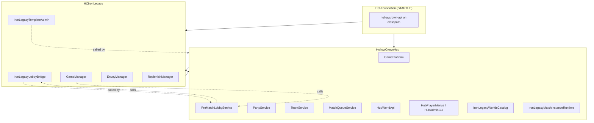

# Hollow Crown Platform — Full Plugin Reference

**Copy-paste lists (keep updated with code changes):**

- [PLATFORM_FEATURES.md](PLATFORM_FEATURES.md) — feature list by plugin and area
- [PLATFORM_COMMANDS.md](PLATFORM_COMMANDS.md) — full command trees and permissions

This document is the **detailed** reference (GUIs, integration flows, config). When you change commands or user-visible features, update the two files above plus `CHANGELOG.md`.

Complete feature, GUI, command, and integration reference for **HC-Foundation**, **HollowCrownHub**, and **HCIronLegacy**.

**Deploy bundle:** three separate JARs (see `docs/PACKAGING.md`). Do not drop `hollowcrown-api` into `plugins/` — it is shaded into Foundation.

| # | JAR | Bukkit name | Load order |
|---|-----|-------------|------------|
| 1 | `HC-Foundation-*.jar` | **HC-Foundation** | `STARTUP` |
| 2 | `HollowCrownHub-*.jar` | **HollowCrownHub** | `POSTWORLD` (depends Foundation) |
| 3 | `HCIronLegacy-*.jar` | **HCIronLegacy** | `POSTWORLD` (depends Foundation + Hub) |

---

## Table of contents

1. [Architecture overview](#1-architecture-overview)
2. [HC-Foundation](#2-hc-foundation)
3. [HollowCrownHub — features](#3-hollowcrownhub--features)
4. [HCIronLegacy — features](#4-hcironlegacy--features)
5. [How the plugins interact](#5-how-the-plugins-interact)
6. [GUI reference (all menus)](#6-gui-reference-all-menus)
7. [Command reference — HollowCrownHub](#7-command-reference--hollowcrownhub)
8. [Command reference — HCIronLegacy](#8-command-reference--hcironlegacy)
9. [Permissions](#9-permissions)
10. [Configuration & data files](#10-configuration--data-files)
11. [Known gaps & planned behavior](#11-known-gaps--planned-behavior)

---

## 1. Architecture overview



**Division of responsibility**

| Concern | Owner |
|---------|--------|
| Hub spawn, protection, hotbar, PvP zone, build mode | **Hub** (`HubWorldApi`) |
| Template registry (Hub rows), join GUI, lobby instances (`*-L#`) | **Hub** |
| Pre-match lobby queue, countdown, lobby loadout, zone clamp | **Hub** (`PreMatchLobbyService`) |
| Parties (persistent social groups) | **Hub** |
| Match teams (Team 1, Team 2, … per lobby/match session) | **Hub** (`TeamService`) |
| Alliances & designated enemies, nametags/TAB/chat colors | **Hub** |
| Plugin policy (Hub / Lobby / Match scopes) | **Hub** |
| Match queue (FIFO units) | **Hub** (enqueue only today) |
| `worlds.yml` template catalog, publish/snapshots, editor worlds | **IL** (Hub writes lobby sections) |
| Match engine: freeze, pads, border, elimination, win | **IL** (`GameManager`) |
| Envoys, replenish, build/dig rules, spawn pads | **IL** |
| Match instance provisioning (optional Hub path) | **Hub** or **IL** (config flag) |

---

## 2. HC-Foundation

### Purpose

HC-Foundation is a **thin bootstrap plugin**. It has no gameplay logic, no commands, and no GUIs. It exists so every other Hollow Crown plugin shares one copy of the API types at runtime.

### What it does

- Loads at **STARTUP** before Hub and minigames.
- **Shades** the `hollowcrown-api` module into the server classpath via Maven Shade.
- Logs on enable: `HC-Foundation loaded (hollowcrown-api schema=…)`.

### What it provides (classpath, not Bukkit services)

All interfaces under `api/src/main/java/com/hollowcrown/api/` are available to Hub and minigames, including:

| Package | Examples |
|---------|----------|
| `platform` | `GamePlatform`, `HubSpawn`, `MatchInstanceReservation` |
| `mechanic` | `MinigameMechanic`, `MinigameBootstrap`, `MechanicContext` |
| `party` | `PartyService`, `PartyView` |
| `team` | `TeamService`, `TeamView`, `TeamChatProvider` |
| `queue` | `MatchQueueService`, `MatchEnqueueResult` |
| `template` | `TemplateRegistry`, `TemplateEntry` |
| `integration` | `HubWorldApi`, `PreMatchLobbyService`, `IronLegacyLobbyBridge`, `IronLegacyTemplateAdmin`, … |

### Dependencies

- **HollowCrownHub** — `depend: [HC-Foundation]` in `plugin.yml`.
- **HCIronLegacy** — `depend: [HC-Foundation, HollowCrownHub]`.
- Future minigames under `minigames/<id>/` follow the same pattern.

### Commands / GUIs / config

None. Foundation is invisible to players and operators except in `/plugins` and startup logs.

---

## 3. HollowCrownHub — features

### 3.1 Hub world & player experience

| Feature | Description | Status |
|---------|-------------|--------|
| **Hub spawn** | `/hch sethub` saves world UUID + coords; `/hub` teleports there. | Implemented |
| **Numbered hub instances** | `/hch sethub 2`, `/hub join 2` — extra spawns in `config.yml` `hub.instances.<n>`. | Implemented |
| **Hub capacity routing** | `hub.instanceCapacity` (default 20): party returns overflow to next numbered hub. | Implemented |
| **Protection radius** | `/hch hubworld size <blocks>` — players inside radius get hub rules. | Implemented |
| **Build mode** | Creative + inventory snapshot for builders; `/hch hubworld buildmode`. | Implemented |
| **Hub hotbar** | Locked slots: compass (join GUI), party star, etc. from `hub-world.yml`. | Implemented |
| **New player teleport** | Optional `teleportNewPlayersToHub` in `hub-world.yml`. | Implemented |
| **Mob spawn toggles** | Hostile/passive in hub protection via `/hch hubworld hostilemobs` / `passivemobs`. | Implemented |
| **PvP zone** | Wand-defined zone; enter with sword → instant PvP; re-enter re-activates; swap off sword → deactivate countdown. | Implemented |
| **PvP pads** | Stand on pad item to toggle PvP mode outside zone rules. | Implemented |
| **Template editor return** | Leaving template edit (`/hub`, evacuate) saves/restores editor inventory + resume spot + build mode. | Implemented (Unreleased) |

### 3.2 Templates & lobbies

| Feature | Description | Status |
|---------|-------------|--------|
| **Hub template registry** | `templates.yml`: key → mechanic id, display name, source world folder, queue policy. | Implemented |
| **Template create** | `/hch template create <key>` — creates IL editable world + Hub row. | Implemented |
| **Lobby instances** | Worlds at `hch-worlds/minigames/<templateKey>-L#`; copy from source; OPEN/BROKEN states. | Implemented |
| **Lobby join (GUI)** | Compass → mechanic tab → template → instance picker or auto-join oldest OPEN. | Implemented |
| **Party-aware lobby join** | Leader moves whole party; capacity checks; party-too-big **trim GUI** (skull kick). | Implemented |
| **Lobby prefetch** | When all OPEN lobbies ≥50% full, prefetch creates fresh lobby in background. | Implemented |
| **Publish destroys lobbies** | Publishing template evacuates players, destroys lobby rows, refreshes instances. | Implemented |
| **Publish gate** | Requires mechanic assigned; chat **yes** flow for vanilla publish confirmation. | Implemented |
| **Mechanic assignment** | `/hch template worlds mechanic <key> <mechanicId>` before publish. | Implemented |

### 3.3 Pre-match lobby

| Feature | Description | Status |
|---------|-------------|--------|
| **Session per lobby world** | Each `*-L#` world has its own lobby session, countdown, player set. | Implemented |
| **Lobby spawn & zone** | Configured in `worlds.yml` per template; wand sets corners; spawn at feet. | Implemented |
| **Lobby loadout** | Adventure mode, cleared inv, hotbar: Match Team (slot 3), Leave (barrier slot 9). | Implemented |
| **Queue countdown** | 5-minute (configurable) fill timer; min-fill % from template; cancels if fill drops. | Implemented |
| **Force start** | `/il start` bypasses min fill (admin). | Implemented |
| **Teleport countdown** | Final seconds before match launch; low-fill cancel during teleport phase. | Implemented |
| **Match launch handoff** | Hub calls `IronLegacyLobbyBridge.startGameOnPreparedInstance`; IL runs match engine. | Implemented |
| **Lobby zone clear** | After spawn-pad teleports, Hub clears blocks/entities in lobby volume. | Implemented |
| **Leave lobby** | Leave item, `/hub`, failed start, evacuate → hub spawn (exits session first). | Implemented |
| **Zone clamp** | Non-OP players cannot leave lobby zone (movement clamped). | Implemented |

### 3.4 Parties (social — persistent)

| Feature | Description | Status |
|---------|-------------|--------|
| **Create / invite / accept / decline** | `/hch party …` + invite paper (left accept, right decline). | Implemented |
| **Leader kick / disband / leave** | Standard party rules; TTL on invites; offline disband timers. | Implemented |
| **Party menu (GUI)** | Nether star hotbar; create, members, invite players, pending invites. | Implemented |
| **Party travels to lobby** | Leader joins lobby → whole online party teleported (if capacity fits). | Implemented |
| **Party hub pull** | Leader `/hub` pulls eligible online members with capacity routing. | Implemented |
| **Separate from match teams** | Party accept does **not** auto-add to leader's match team. | Implemented |

### 3.5 Match teams (session — per lobby/match)

| Feature | Description | Status |
|---------|-------------|--------|
| **Team 1, Team 2, … naming** | Numbered team names with `[Team N]` nametag prefix. | Implemented |
| **Match Team menu (slot 3)** | Create team, invite, accept/decline, members, leave — mirrors party UX. | Implemented |
| **Team cap** | Template `teamSizeMax` in lobby; global `teams.memberCap` fallback. | Implemented |
| **Color modes** | **TEAM mode**: auto RGB prefix colors + relationship name colors. **LEGACY**: wool picker. | Implemented |
| **Reset on lobby entry** | Stale team cleared when entering a new lobby. | Implemented |
| **Party auto-team on lobby join** | Party placed on one team up to cap; solo gets create/join prompt. | Implemented (Unreleased) |
| **Session-scoped cleanup** | Lobby destroy / match end clears teams **only for that session's players**. | Implemented (Unreleased) |
| **Independent invites** | Any player can invite others to their team (not party-locked). | Implemented |

### 3.6 Alliances & enemies

| Feature | Description | Status |
|---------|-------------|--------|
| **`/ally <team>`** | Team leader sends alliance invite to another team leader. | Implemented |
| **`/ally accept <team>`** | Accept pending alliance. | Implemented |
| **`/enemy <team>`** | Mark designated enemy (orange nametags). | Implemented |
| **Alliance caps** | Per-template `allyMaxTeams` in template policy. | Implemented |
| **Friendly fire toggles** | Template policy: team FF, ally FF. | Implemented |
| **Last-group lockout** | When one alliance remains, designated rules apply. | Implemented |
| **Gated by template** | `alliesEnabled` must be true on template policy. | Implemented |

### 3.7 Nametags, TAB, chat

| Feature | Description | Status |
|---------|-------------|--------|
| **Per-viewer scoreboards** | Each player in lobby/match gets private scoreboard for others' nametags. | Implemented |
| **Relationship colors** | Green teammate, red enemy, blue ally, orange designated enemy. | Implemented |
| **Team prefix** | `[Team N]` with team RGB (TEAM mode) or legacy ChatColor. | Implemented |
| **Sneak hides nametag** | When template policy `shiftHidesNameTag` enabled. | Implemented |
| **TAB visibility** | Per-template `tabVisible` — can hide from tab list. | Implemented |
| **Chat/death formatting** | `HubNametagChatListener` prefixes names consistently. | Implemented |
| **Refresh on team change** | Create/join/leave triggers world-wide nametag resync (+ next tick). | Implemented (Unreleased) |
| **Lobby world template resolution** | `*-L#` worlds resolve template policy for colors. | Implemented (Unreleased) |

### 3.8 Match queue

| Feature | Description | Status |
|---------|-------------|--------|
| **Enqueue solo or party unit** | `/hch queue join <templateKey>`. | Implemented |
| **Queue policy gates** | `soloOnly`, `maxUnitSize`, `soloAutoMerge`, `joinQueueFirst` per template. | Implemented |
| **Queue bypass** | OP permission `hollowcrownhub.queue.bypass`. | Implemented |
| **Queue overview GUI** | Admin shell → Queues tab. | Implemented |
| **Auto-dequeue to lobby** | Queue does **not** yet auto-teleport when slot opens. | **Gap** — enqueue only |

### 3.9 Plugin policy

| Feature | Description | Status |
|---------|-------------|--------|
| **Global scopes** | Hub / Lobby / Match whitelist or blacklist per plugin id. | Implemented |
| **Per-template overrides** | Match-scope plugin list overrides global for that template. | Implemented |
| **Command blocking** | `HubPluginPolicyEnforcer` blocks disallowed plugin commands in scope. | Implemented (best-effort) |
| **Policy GUIs** | Plugin Allocation landing + per-template blacklist tab. | Implemented |
| **Save on close** | Template policy GUIs persist when inventory closed. | Implemented |
| **Kick on policy change** | Players kicked from lobbies when template policy changes invalidate them. | Implemented |

### 3.10 Admin & debug

| Feature | Description | Status |
|---------|-------------|--------|
| **Admin shell GUI** | Central hub for maps, templates, queues, lobbies, policies. | Implemented |
| **IL template admin GUI** | List → detail → publish/edit/snapshots/lobby tools. | Implemented |
| **Debug mechanics / why** | `/hch debug mechanics`, `/hch debug why <player>`. | Implemented |
| **MySQL storage (optional)** | Parties, lobbies, queues mirrored when `storage.type=MYSQL`. | Implemented |

### 3.11 Services Hub registers

| Service | Implementation |
|---------|----------------|
| `GamePlatform` | `DefaultGamePlatform` |
| `HubWorldApi` | `HubWorldManager` |
| `TemplateRegistry` | `HubTemplateApiRegistry` |
| `PartyService` | `HubPartyService` |
| `TeamService` | `HubTeamService` |
| `MatchQueueService` | `HubMatchQueueService` |
| `HubPlayerMenus` | `DefaultHubPlayerMenus` |
| `HubAdminGui` | `DefaultHubAdminGui` |
| `IronLegacyWorldsCatalog` | `HubLobbyWorldsYaml` |
| `IronLegacyMatchInstanceRuntime` | `HubIronLegacyMatchInstanceRuntime` |
| `PreMatchLobbyService` | `HubPreMatchLobbyService` |
| `HubTemplatePublishLifecycle` | publish callback lambda |
| `HubPluginPolicyApi` | `HubPluginPolicyApiAdapter` |

---

## 4. HCIronLegacy — features

### 4.1 Match engine

| Feature | Description | Status |
|---------|-------------|--------|
| **States** | LOBBY → FREEZE → RUNNING → ENDED. | Implemented |
| **Spawn pad assignment** | 1:1 player-to-pad; shuffle; fail if insufficient pads. | Implemented |
| **Hard freeze countdown** | Title/subtitle countdown; move penalty (launch or half-heart). | Implemented |
| **World border** | Center on spawn; shrink delay/duration from config or `/il border set`. | Implemented |
| **Elimination & win** | Last team/player standing; death messages optional. | Implemented |
| **Saturation on spawn** | 2.5 bars on match teleport. | Implemented |
| **Join intent** | Counted vs OP-bypass vs forced participants. | Implemented |
| **Session team cleanup** | `clearTeamsFor(participants)` on match end — not global wipe. | Implemented (Unreleased) |
| **Replenish schedule** | Tiered chest refill during match; stops on match end. | Implemented |
| **Hooks** | `hooks.onGameStart` / `onGameEnd` in config. | Implemented |

### 4.2 Templates & worlds

| Feature | Description | Status |
|---------|-------------|--------|
| **`worlds.yml` catalog** | Template keys, world folders, status EDIT/PUBLISHED, version, caps. | Implemented |
| **Editor worlds** | Creative edit mode; inventory save/restore; resume position. | Implemented |
| **Publish / snapshot / rollback** | Versioned snapshots on publish; rollback to snapshot id. | Implemented |
| **Import from Hub** | `/hch template worlds importhub` syncs Hub rows into IL YAML. | Implemented |
| **Stale instance recovery** | On reload, scans and cleans orphaned instance folders. | Implemented |
| **Hub template merge** | `integrations.mergeHubTemplatesIntoList: true` merges Hub registry. | Implemented |
| **Hub match provisioning** | `integrations.preferHubMatchInstanceProvisioning` — Hub creates match worlds. | Implemented (flag) |

### 4.2 Lobby bridge (IL side)

| Feature | Description | Status |
|---------|-------------|--------|
| **`IronLegacyLobbyBridge`** | Hub calls this for templates, instances, game start, hub return. | Implemented |
| **Team assign at launch** | Optional auto-assign for un-teamed players at match start (IL logic). | Implemented |
| **Velocity routing** | Cross-server hub connect when proxy enabled and hub ≠ this server. | Implemented |
| **Kill credit** | Records kills for leaderboard when in hub PvP zone. | Implemented |

### 4.3 Envoys

| Feature | Description | Status |
|---------|-------------|--------|
| **Falling crates** | Parachute entities, fireworks, loot packages. | Implemented |
| **Per-template spawns** | `world-envoys/<key>/envoys.yml`. | Implemented |
| **Wave / random forager** | `/il envoy wave`, `random`. | Implemented |
| **Admin GUI tree** | Types, packages, spawns, tracking. | Implemented |
| **Add chest mode** | Wand to mark envoy chests. | Implemented |

### 4.4 Replenish

| Feature | Description | Status |
|---------|-------------|--------|
| **Tiers T1–T4** | Manual trigger or scheduled refill. | Implemented |
| **Replenish mode wand** | Mark chests for tier assignment. | Implemented |
| **Chest protection** | Marked chests protected from break. | Implemented |
| **Admin GUI** | Replenish admin + chest list menus. | Implemented |

### 4.5 Rules & spawns

| Feature | Description | Status |
|---------|-------------|--------|
| **Build/dig whitelist/blacklist** | Material categories from `categories.yml`. | Implemented |
| **Crafting toggle** | `/il crafting on|off`. | Implemented |
| **Spawn pads** | add/clear/ring/list/showpads — persisted in config. | Implemented |
| **Pickup guard** | Freeze-phase pickup restrictions. | Implemented |
| **Random teams (admin)** | `/il randomteams` for testing. | Implemented |

### 4.6 Teams (delegated to Hub)

| Feature | Description | Status |
|---------|-------------|--------|
| **`TeamManager` wrapper** | All CRUD delegates to Hub `TeamService`. | Implemented |
| **Legacy IL team GUIs** | MainMenu, TeamsMenu, etc. — used outside lobby / admin. | Implemented |
| **In lobby** | `/il teams` opens Hub party/team menus instead. | Implemented |
| **Team chat provider** | `TeamChatProvider` SPI for prefix/color in chat mods. | Implemented |

### 4.7 Multi-server & roles

| Feature | Description | Status |
|---------|-------------|--------|
| **Server roles** | `standalone`, `hub`, `game`, `edit` in `gameflow.yml`. | Implemented |
| **Lobby shards** | Hub shard assignment + boundary listener. | Implemented |
| **Shared state** | FILE backend default for cross-server data. | Implemented |

### 4.8 Services IL registers

| Service | Implementation |
|---------|----------------|
| `IronLegacyLobbyBridge` | `IronLegacyLobbyBridgeImpl` |
| `IronLegacyTemplateAdmin` | `IronLegacyTemplateAdminImpl` |
| `IronLegacyHubBridge` | `IronLegacyHubBridgeImpl` |
| `GameWorldScopeResolver` | `IlGameWorldScopeResolver` |
| `TeamChatProvider` | `IronLegacyTeamChatProvider` |
| `MinigameMechanic` | `IronLegacyMechanic` (via `GamePlatform`) |

---

## 5. How the plugins interact

### 5.1 Startup sequence

1. **HC-Foundation** — API types on classpath.
2. **HollowCrownHub** — registers platform services (party, team, lobby, etc.).
3. **HCIronLegacy** — requires `GamePlatform`; registers `IronLegacyLobbyBridge`, `IronLegacyTemplateAdmin`, mechanic `iron-legacy`; attaches lobby listener to Hub's `PreMatchLobbyService`.

If Hub is missing, IL **disables itself**.

### 5.2 Player journey: join game → match → hub

```
Hub spawn (compass)
  → LobbyJoinMechanicMenu (pick mechanic, e.g. Iron Legacy)
  → LobbyJoinTemplateMenu (pick template)
  → [optional] LobbyJoinInstanceMenu OR auto-join oldest OPEN lobby
  → HubLobbyService.teleportPlayerJoin
  → PreMatchLobbyService.registerHubLobbyJoin
       • clear stale personal team
       • party auto-team (if in party)
       • lobby loadout + spawn
       • queue countdown
  → [optional] Match Team menu (slot 3) — create/invite teams
  → countdown completes → IronLegacyLobbyBridge.startGameOnPreparedInstance
  → GameManager: freeze → pads → RUNNING
  → match end OR /il stop
  → evacuate to hub (party routing, template editor inventory save if applicable)
  → session-scoped team clear
  → lobby folder destroy (if applicable)
```

### 5.3 Template publish flow

```
Admin: /hch template worlds publish <key>  OR  GUI Publish button
  → IronLegacyTemplateAdmin.publish()
  → snapshot + version bump in worlds.yml
  → HubTemplatePublishLifecycle.onTemplatePublished()
       • register template-policies.yml row
       • destroy OPEN lobbies for that template
       • evacuate players to hub
       • optional prefetch fresh lobby
```

### 5.4 Template edit flow

```
Admin: /hch template worlds edit <key>  OR  General Settings → Teleport to editor
  → IronLegacyTemplateAdmin.teleportToEditor()
       • capture hub build mode if leaving lobby
       • save editor inventory if already in template
       • teleport to resume spot or template spawn
       • restore saved editor inventory or clear + creative
  → build in template world
  → /hub or evacuate
       • save inventory + resume spot
       • restore hub build mode / survival loadout
```

### 5.5 API call direction summary

| Caller | Callee | Interface | Purpose |
|--------|--------|-----------|---------|
| Hub | IL | `IronLegacyLobbyBridge` | Start match, templates, instances, hub return |
| Hub | IL | `IronLegacyTemplateAdmin` | Publish, edit TP, reload, import |
| IL | Hub | `PreMatchLobbyService` | All lobby queue UX |
| IL | Hub | `TeamService` | Team CRUD |
| IL | Hub | `PartyService` | Party graph at launch |
| IL | Hub | `HubWorldApi` | Hub spawn, loadouts, PvP |
| IL | Hub | `HubPlayerMenus` | Open join/party GUIs |
| IL | Hub | `IronLegacyMatchInstanceRuntime` | Create/destroy match worlds |
| IL | Hub | `IronLegacyWorldsCatalog` | Read/write worlds.yml lobby fields |
| IL | Hub | `HubTemplatePublishLifecycle` | Callback after publish |
| Both | Both | `GamePlatform` | Mechanics, hub spawn, reservations |

---

## 6. GUI reference (all menus)

### 6.1 Player GUIs (Hub)

#### Join flow (compass hotbar)

| Menu | Rows | Contents | Actions |
|------|------|----------|---------|
| **LobbyJoinMechanicMenu** | 6 | One icon per registered mechanic + Vanilla | Click mechanic → template list; prev/next pages; close |
| **LobbyJoinTemplateMenu** | 6 | Template icons for selected mechanic | **Left-click**: join oldest OPEN lobby OR enqueue if `joinQueueFirst`; **Right-click**: instance picker; back |
| **LobbyJoinInstanceMenu** | 6 | OPEN lobby instances for template | Click instance → join; **Leave Lobby** (barrier) → hub; back |

#### Party (nether star hotbar — hub & lobby)

| Menu | Contents | Actions |
|------|----------|---------|
| **HubPartyMenu** | Create party, view members, invite players, pending invites, **Match Team** (lobby only) | Navigation to submenus |
| **HubPartyInvitePlayersMenu** | Online player heads | Click → send party invite |
| **HubPartyMembersMenu** | Member heads, kick (leader) | Paginated |
| **HubPartyPendingInvitesMenu** | Invite papers | Left accept / right decline |
| **HubPartyLobbyTrimMenu** | Party member skulls when party too big for lobby | Kick member → retry join; cancel |

#### Match Team (lobby slot 3 only)

| Menu | Contents | Actions |
|------|----------|---------|
| **HubTeamMenu** | Create team, members, invite, pending invites, link to party menu | **Create**: auto color (TEAM mode) or wool swatches (LEGACY); cap from `teamSizeMax` |
| **HubTeamMembersMenu** | Roster | Leave team |
| **HubTeamInvitePlayersMenu** | Players in same lobby session | Send team invite |
| **HubTeamPendingInvitesMenu** | Pending team invites | Accept / decline |
| **HubLobbyTeamMenu** | *(deprecated)* | Delegates to `HubTeamMenu` |

### 6.2 Admin GUIs (Hub)

#### Shell & overview

| Menu | Contents | Actions |
|------|----------|---------|
| **HubAdminShellMenu** | Tiles: IL Maps, Hub Templates, Queues, Lobbies, Plugin Policies | Click tile → sub-menu; refresh; close |
| **HubHubTemplateBrowserMenu** | Read-only `templates.yml` rows | Paginated books; tip to `/hch template get` |
| **HubQueueOverviewMenu** | Per-template queue depth + waiting units | View only |
| **LobbyAdminMenu** | Lobby instance rows (OPEN=lime, BROKEN=barrier) | Click TP; **Shift-click** destroy; BROKEN → forget |

#### Iron Legacy template admin

| Menu | Contents | Actions |
|------|----------|---------|
| **HubIlTemplateListMenu** | All IL maps from worlds.yml | Click → detail; reload; import from Hub; paging |
| **HubIlTemplateDetailMenu** | Per-map actions | Teleport editor, Publish, Delete, Snapshots, Toggle enabled, Icon preview, Lobby wand, Lobby spawn here, Back |
| **HubIlSnapshotListMenu** | Snapshot ids | Click → rollback confirm |
| **HubIlIconPreviewMenu** | Icon item preview | Display only; close |

#### Template policy

| Menu | Contents | Actions |
|------|----------|---------|
| **HubPluginAllocationLandingMenu** | Tabs: Hub / Lobby / Match global policy | Opens scoped policy menu |
| **HubPluginPolicyAdminMenu** | Plugin book list | Toggle whitelist/blacklist; add/remove plugins |
| **HubMatchTemplateListMenu** | Template picker | → per-template landing |
| **HubTemplateLandingMenu** | General Settings / Plugin Allocation tabs | Navigate |
| **HubTemplateGeneralSettingsMenu** | Toggles: color mode, sneak hide, TAB, allies, friendly fire, ally max, team size, min %, max players | Adjust values; **Teleport to editor** |
| **HubTemplateBlacklistMenu** | Per-template plugin override list | Same interaction as global policy |

### 6.3 Iron Legacy GUIs (in-game `/il gui` or `/il admin`)

#### Player / team (legacy — primarily outside Hub lobby)

| Menu | Purpose |
|------|---------|
| **MainMenu** | Team hub: create, join, invite entry |
| **TeamsMenu** | List all teams on server |
| **JoinTeamMenu** | Accept team invites |
| **InviteMenu** | Invite players to your team |
| **TeamColorMenu** | Legacy wool color picker |
| **GameLobbyMenu** | Legacy compass world selector (superseded by Hub join GUI when Hub present) |

#### Admin control center

| Menu | Purpose |
|------|---------|
| **AdminControlCenterMenu** | Envoy, Replenish, Reload, Hub status, history |
| **WorldsAdminRootMenu** | Hub settings, team names, game worlds |
| **WorldsHubSettingsMenu** | Lobby border, mob spawns (legacy — prefer Hub `/hch hubworld`) |
| **GameWorldsListMenu** | Template list |
| **GameWorldSettingsMenu** | Per-template IL settings |
| **CoreSettingsAdminMenu** | Core game toggles |
| **TeamNameDatabaseAdminMenu** | Preset random team names |

#### Envoy admin tree

`EnvoyAdminMenu` → General Settings, Types, Packages, Package Edit, Spawns, Packages Tracking

#### Replenish admin tree

`ReplenishAdminMenu` → ReplenishChestsMenu

### 6.4 Hotbar item map (Hub)

| Slot | Item | World | Opens |
|------|------|-------|-------|
| Compass (config slot, default 5) | Hub | Join GUI |
| Slot 9 | Nether star | Hub | Party menu |
| Slot 3 | Team item | Lobby only | Match Team menu |
| Slot 9 | Barrier | Lobby only | Leave → hub |

---

## 7. Command reference — HollowCrownHub

**Root commands:** `/hch` · `/hub` · `/ally` · `/enemy`  
**Aliases:** `hollowcrownhub`, `hchub` · `lobby`, `spawnhub`

### `/hch` — Hollow Crown Hub admin & platform

Permission: subcommands use `hollowcrownhub.use` (help), `hollowcrownhub.admin` (most admin), or specific nodes below.

```
/hch
├── help                          Show command help (admin sections hidden from non-ops)
├── version                       [admin] Hub version + API schema
│
├── party                         [hollowcrownhub.party] Party social groups
│   ├── create                    Create a party (you become leader)
│   ├── invite <player>           Send invite paper to player
│   ├── leave                     Leave current party
│   ├── disband                   Leader disbands party
│   ├── kick <player>             Leader removes member
│   ├── accept <partyId>          Accept invite by party UUID
│   ├── decline <partyId>         Decline invite
│   └── list                      [admin] List all parties on server
│
├── queue                         [hollowcrownhub.queue] Match queue (enqueue only)
│   ├── join <templateKey>        Add solo or party unit to template queue
│   ├── leave                     Leave queue
│   └── status [templateKey]      Show your position or dump template queue
│
├── join [gui] [page]             [hollowcrownhub.join] Open join game GUI (compass equivalent)
│
├── hubworld                      [admin] Hub protection & PvP zone
│   ├── size <blocks>             Protection radius from hub spawn
│   ├── buildmode <true|false>    Toggle creative build mode (alias: bm)
│   ├── pvp
│   │   ├── wand                  Give PvP zone selection wand
│   │   ├── setspawn              Set PvP zone spawn at your feet
│   │   └── pad                   Give PvP pad item
│   ├── hostilemobs <true|false>  Allow hostile mob spawns in hub (aliases: hostilemobspawn, …)
│   └── passivemobs <true|false>  Allow passive mob spawns in hub
│
├── sethub [n]                    [admin] Save hub spawn at feet (#1 default, or numbered instance)
├── clearhub [n]                  [admin] Remove numbered hub spawn
│
├── lobby                         [admin] Lobby instance management
│   ├── list                      List OPEN/BROKEN lobby rows
│   ├── gui [page]                Open lobby admin chest GUI
│   ├── create <templateKey>      Create new OPEN lobby instance (-L#)
│   ├── destroy <id>              Evacuate, unload, delete folder, remove row
│   ├── forget <id>               Remove BROKEN row after manual folder delete
│   └── tp <id>                   Teleport to lobby instance world
│
├── template                      [admin] Hub template registry + IL worlds admin
│   ├── list                      List Hub templates.yml rows
│   ├── create <key> [display…]   Create IL editable world + Hub row (in-game, OP)
│   ├── get <key>                 Show template row details
│   ├── remove <key>              Remove Hub template row
│   ├── set
│   │   ├── <key> <mechanicId> [display]   Register template mechanic + display name
│   │   ├── <key> display|enabled|maxplayers|teamsize|icon|minimumpercentage|gamerule …
│   │   │                                  (IL worlds.yml fields when IL loaded)
│   ├── setsource <key> <worldFolder>      Set source world folder for lobby copies
│   ├── setqueue <key> <policy> <value>    Queue policy: maxUnitSize | soloOnly | soloAutoMerge | joinQueueFirst
│   ├── lobby                              Lobby circle zone + spawn (writes worlds.yml)
│   │   ├── wand                           Center LMB, edge RMB, Shift+scroll, shift-right save
│   │   ├── spawn                          Set lobby spawn at feet inside the saved circle
│   │   └── help                           Lobby wand help
│   └── worlds                             [requires IL] Iron Legacy worlds.yml admin
│       ├── help | ?                       Subcommand help
│       ├── list                           Summarize all IL template rows
│       ├── reload                         Reload IL configs, templates, icons, rules
│       ├── importhub [key] [--dry-run] [--sync]   Import Hub registry rows into IL YAML
│       ├── mechanic <world|key> <mechanicId>      Assign mechanic (required before publish)
│       ├── edit <world|key>               Teleport to template editor (inventory save/restore)
│       ├── publish <world|key>            Snapshot + publish (destroys lobbies, chat yes gate)
│       ├── delete <world|key>             Delete template row + world folder
│       ├── rollback <world|key> [snapshot]  Rollback to snapshot id or latest
│       ├── snapshots <world|key>          List snapshot ids
│       ├── toggle <world|key>             Toggle template enabled flag
│       ├── iconpreview [iconKey]          Preview template GUI icon item
│       └── gui                            Redirect to /hch worldsgui
│
├── gui                           [admin] Admin GUI shortcuts
│   ├── help | ?
│   ├── admin | home | shell      Open admin shell menu
│   ├── maps | ironlegacy | il    IL template list GUI
│   ├── templates | hubtemplates | tpl   Hub templates browser
│   ├── queues | queue | q        Queue overview GUI
│   └── lobby | lobbies | l       Lobby admin GUI
│
├── worldsgui | worldgui          [admin] Alias → IL template list GUI
├── ironlegacy                    [admin] Deprecated → points to template worlds / gui maps
│
└── debug                         [admin]
    ├── mechanics                 List registered minigame mechanic ids
    └── why <player>              Snapshot: world, lobby, party, team, queue state
```

### `/hub` — Player hub teleport

Permission: `hollowcrownhub.use`

```
/hub                              Teleport to hub #1; party leader pulls online party (capacity routing)
/hub join <hubNumber>             Teleport to numbered hub spawn (from /hch sethub <n>)
```

Aliases: `lobby`, `spawnhub`

**Behavior:** Exits lobby first (same as Leave Lobby). Saves template editor inventory if leaving editor world. Applies hub loadout after teleport.

### `/ally` — Team alliances (in match/lobby when policy allows)

```
/ally <teamName>                  Team leader sends alliance invite
/ally accept <teamName>           Team leader accepts pending alliance
```

### `/enemy` — Designated enemy (orange nametags)

```
/enemy <teamName>                 Team leader marks another team as sworn enemy
```

---

## 8. Command reference — HCIronLegacy

**Root command:** `/il` (alias: `ironlegacy`)  
Permission: `hcironlegacy.use` (default true); admin subcommands require OP / `hcironlegacy.admin`

```
/il
├── [help]                        Show help (default when no args)
│
├── party                         Open Hub party menu (HubPlayerMenus) — requires Hub
├── teams                         In lobby: Hub Match Team menu; else OP team admin GUI
├── gui                           OP: open MainMenu or TeamsMenu (config ui.openTeamsFirst)
├── admin                         OP: AdminControlCenterMenu
│
├── leaderboard | lb              Top 10 kill leaderboard
│
├── joingame <worldname>          [OP] Bypass join to world
├── reload                        [OP] Reload config, files, spawns, rules, templates, icons
│
├── start [lobby_world|template]  [role: GAME or STANDALONE] Force lobby countdown (ignores min fill)
├── stop                          Abort lobby queues + stop active match → send players to hub
│
├── hostilemobspawn <true|false>  [OP, HUB/STANDALONE] Toggle hostile mob spawns in lobby
├── passivemobspawn <true|false>  [OP, HUB/STANDALONE] Toggle passive mob spawns in lobby
│
├── addspawn                      [OP] Add spawn pad at feet
├── clearspawn [closest|all]      [OP] Remove closest pad (default) or clear all
├── listspawns                    [OP] List spawn pad count
├── addspawnring <count> <radius> [here|spawn]  [OP] Ring of pads
├── showpads [seconds]            [OP] Show pad particles temporarily
│
├── randomteams <size> [forceop]  [OP] Randomly assign teams for testing
│
├── rules                         [OP] Show current build/dig/craft rules
├── crafting <on|off>             [OP] Toggle crafting in match
├── build                         [OP] Build permission management
│   ├── enable | disable
│   ├── mode <whitelist|blacklist>
│   ├── add <material>
│   ├── remove <material>
│   └── list
├── dig                           [OP] Dig permission (same structure as build)
│   ├── enable | disable
│   ├── mode <whitelist|blacklist>
│   ├── add | remove | list
│
├── set                           [OP] Live match settings
│   ├── teamsize <n>
│   ├── countdown <seconds>
│   ├── penaltyheight <blocks>
│   └── titlecolor <color>
│
├── border set <start> <end> <delaySec> <durationSec>   [OP] World border parameters
│
├── toggle                        [OP] Feature toggles
│   ├── deathmsgs
│   ├── cannon
│   ├── defaultteams
│   └── launchonmove
│
├── giftdrop                      [OP] Trigger gift drop for self
│
├── envoy                         [OP] Envoy crate system
│   ├── start | stop
│   ├── addloc | clearlocs | listlocs
│   ├── wave [count]
│   ├── random [count]
│   └── gui                       Open envoy admin GUI
│
├── addchests                     [OP] Envoy chest marking mode
│   ├── start | stop | give
│
├── replenish                     [OP] Chest replenish system
│   ├── T1 | T2 | T3 | T4         Manual tier trigger
│   └── mode
│       ├── start | stop | give   Replenish wand mode
│
├── game | gameedit               DEPRECATED → use /hch template worlds … or /hch gui maps
│
└── (help documents Hub commands: /hub, /hch sethub, /hch template …)
```

**Moved to Hub (not in IL):** template create, publish, worlds admin GUI, lobby circle wand (Hub `/hch template lobby wand`), join compass flow, party commands, queue, lobby admin.

---

## 9. Permissions

### HollowCrownHub

| Node | Default | Description |
|------|---------|-------------|
| `hollowcrownhub.use` | true | `/hub`, basic access |
| `hollowcrownhub.join` | true | Join GUI + lobby teleport |
| `hollowcrownhub.party` | true | `/hch party …` + party menu |
| `hollowcrownhub.queue` | true | `/hch queue …` |
| `hollowcrownhub.queue.bypass` | op | Bypass solo-only and max-unit queue gates |
| `hollowcrownhub.admin` | op | All `/hch` admin, GUIs, template/lobby/hubworld |

### HCIronLegacy

| Node | Default | Description |
|------|---------|-------------|
| `hcironlegacy.use` | true | `/il` player commands |
| `hcironlegacy.admin` | op | `/il` admin sections (implicit via OP checks in HGCommand) |

---

## 10. Configuration & data files

### HollowCrownHub (`plugins/HollowCrownHub/`)

| File | Purpose |
|------|---------|
| `config.yml` | Storage, party timers, `hub.instanceCapacity`, hub spawns, `teams.memberCap` |
| `templates.yml` | Template key → mechanic, display, source world, queue policy |
| `hub-world.yml` | Protection radius, PvP zone/pads, hotbar items, mob spawns |
| `parties.yml` | Party persistence |
| `teams.yml` | Match team persistence (session teams also cleared on teardown) |
| `team-name-database.yml` | Optional team name pool |
| `plugin-policies.yml` | Global Hub/Lobby/Match plugin lists |
| `template-policies.yml` | Per-template match settings + plugin overrides |
| `storage-meta.yml` | YAML storage schema version |

### HCIronLegacy (`plugins/HCIronLegacy/`)

| File | Purpose |
|------|---------|
| `config.yml` | Game settings, integrations, rules, spawns, UI |
| `worlds.yml` | Template catalog, lobby zones/spawns, per-template match spawn pads, min-fill %, team caps |
| `gameflow.yml` | Server role, Velocity, shard caps, team defaults |
| `lobby.yml` | Legacy lobby coords (migrated toward Hub) |
| `envoys.yml` + `world-envoys/<key>/` | Envoy definitions per map |
| `replenish.yml` | Shared replenish tiers + schedule |
| `world-envoys/<key>/replenish-locations.yml` | Per-map replenish chest coordinates |
| `categories.yml` | Build/dig material groups |
| `icons.yml` | Template join GUI icons |
| `resourcepack.yml` | Optional server resource pack |

### Server disk (not under plugins/)

| Path | Purpose |
|------|---------|
| `hch-worlds/minigames/<template>-L#/` | Hub lobby instance worlds |
| `hch-worlds/templates/` | Published template snapshots / match clones |
| Template source folders | As set by `/hch template setsource` |

---

## 11. Known gaps & planned behavior

| Item | Expected | Current |
|------|----------|---------|
| **Queue → lobby auto-dequeue** | Queue should send units when lobby slot opens | Enqueue + status only; join via GUI |
| **`HubPluginPolicyApi`** | External HC plugins query policy | API exists; no in-game test |
| **IL legacy team GUIs in lobby** | Use Hub Match Team only | `/il teams` redirects to Hub in lobby |
| **Global `clearAllTeams`** | Admin nuke / stale recovery only | Not called on normal match end |
| **Velocity multi-server** | Full cross-server lobby + match | Routing exists; single-server stack is primary test target |

---

## Quick cross-reference: who owns what command topic?

| Topic | Primary commands | GUI entry |
|-------|------------------|-----------|
| Hub spawn | `/hch sethub`, `/hub` | — |
| Join game | `/hch join` | Compass → Join menus |
| Party | `/hch party` | Nether star |
| Match team | — (lobby slot 3) | Match Team menu |
| Lobby admin | `/hch lobby` | Admin shell → Lobbies |
| Template registry | `/hch template set/list` | Admin shell → Hub Templates |
| IL worlds admin | `/hch template worlds …` | `/hch gui maps` |
| Lobby zone/spawn | `/hch template lobby wand/spawn` | IL detail menu buttons |
| Template policy | — | Admin shell → Plugin Policies → template |
| Match queue | `/hch queue` | Admin shell → Queues |
| Alliances | `/ally`, `/enemy` | — |
| Match control | `/il start`, `/il stop` | — |
| Spawn pads | `/il addspawn`, ring, … | — |
| Envoys / replenish | `/il envoy`, `/il replenish` | `/il admin` → submenus |
| Hub PvP zone | `/hch hubworld pvp …` | — |

---

*Generated from HC-Platform source and `docs/IN_GAME_FULL_TEST.md`. Update this doc when adding commands, GUIs, or integration contracts.*
